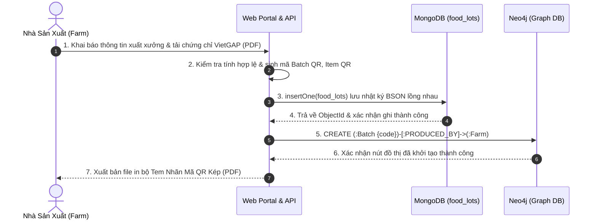
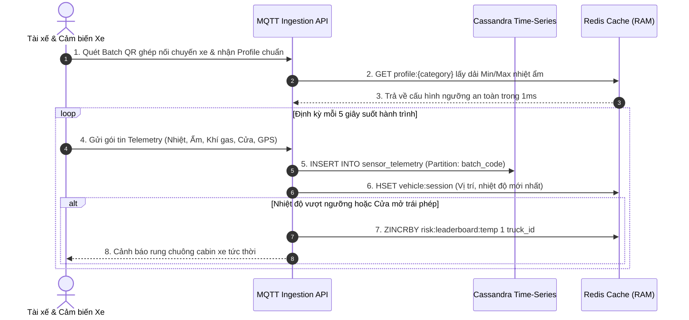
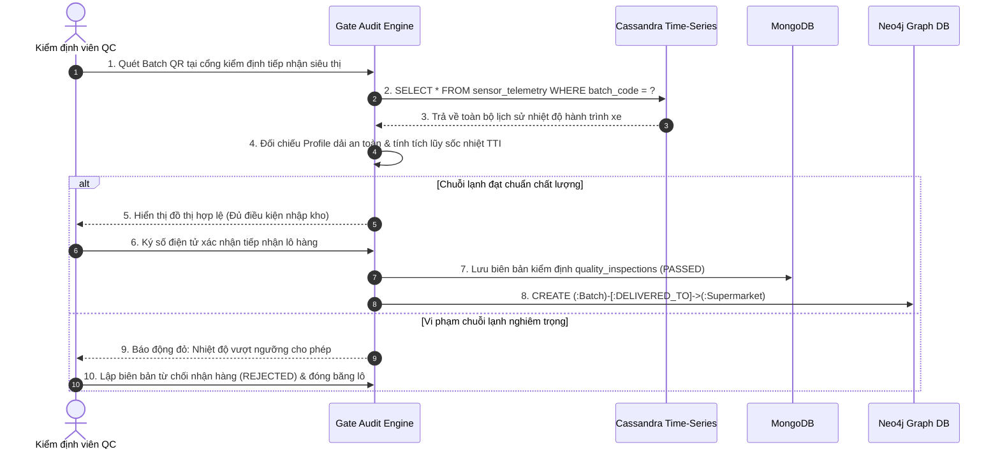
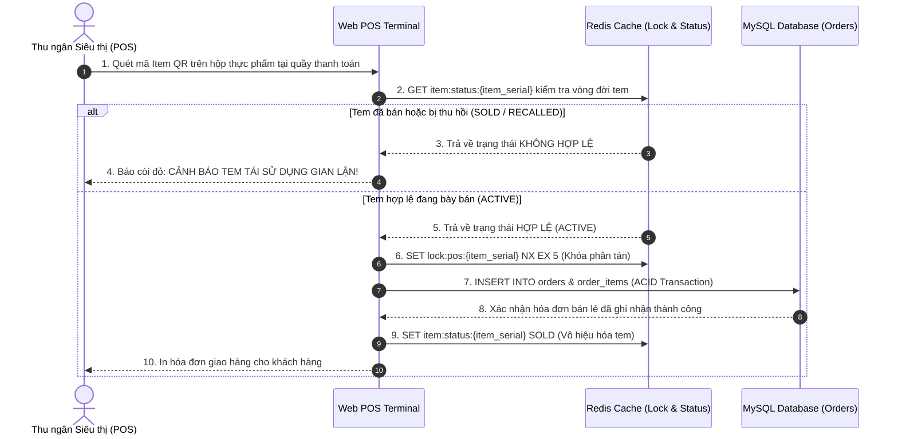
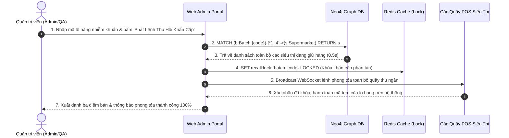

# TỔNG QUAN KIẾN TRÚC & ĐẶC TẢ TOÀN BỘ HỆ THỐNG MỚI NHẤT
## HỆ THỐNG WEB TRUY VẾT THỰC PHẨM SIÊU THỊ
### (Supermarket Food Traceability Web System)
> **Phiên bản:** 2.1 (Cập nhật toàn bộ chức năng từng nút bấm Web & Mobile — Tháng 09/2026)  
> **Đơn vị thực hiện:** Nhóm 3 — Lớp 14DHTH01 — Khoa Công nghệ Thông tin — Trường Đại học Công Thương TP. Hồ Chí Minh (HUIT)  
> **Môn học phụ trách:** Đồ án Dữ liệu NoSQL (Kết hợp Chuỗi Cung Ứng Lạnh IoT)  
> **Kiến trúc trọng tâm:** Phân tầng 4 Lớp + Lưu trữ Đa mô hình Polyglot Persistence (MySQL + MongoDB + Redis + Cassandra + Neo4j)

---

## MỤC LỤC TỔNG QUAN

1. [PHẦN 1: BỐI CẢNH HỆ THỐNG & MỤC TIÊU NGHIỆP VỤ](#phần-1-bối-cảnh-hệ-thống--mục-tiêu-nghiệp-vụ)
2. [PHẦN 2: KIẾN TRÚC PHÂN TẦNG VÀ LƯU TRỮ ĐA MÔ HÌNH (POLYGLOT NOSQL)](#phần-2-kiến-trúc-phân-tầng-và-lưu-trữ-đa-mô-hình-polyglot-nosql)
3. [PHẦN 3: TÁC NHÂN NGƯỜI DÙNG & MA TRẬN PHÂN QUYỀN RBAC](#phần-3-tác-nhân-người-dùng--ma-trận-phân-quyền-rbac)
4. [PHẦN 4: ĐẶC TẢ CA SỬ DỤNG CỐT LÕI (USE CASE SPECIFICATIONS)](#phần-4-đặc-tả-ca-sử-dụng-cốt-lõi-use-case-specifications)
5. [PHẦN 5: ĐẶC TẢ 5 QUY TRÌNH NGHIỆP VỤ & SƠ ĐỒ HOẠT ĐỘNG / TUẦN TỰ](#phần-5-đặc-tả-5-quy-trình-nghiệp-vụ--sơ-đồ-hoạt-động--tuần-tự)
6. [PHẦN 6: THIẾT KẾ CƠ SỞ DỮ LIỆU ĐA MÔ HÌNH (POLYGLOT DATA ARCHITECTURE)](#phần-6-thiết-kế-cơ-sở-dữ-liệu-đa-mô-hình-polyglot-data-architecture)
7. [PHẦN 7: ĐẶC TẢ CHI TIẾT TOÀN BỘ CHỨC NĂNG TRÊN TỪNG NÚT BẤM (93 CHỨC NĂNG WEB & MOBILE THEO 8 ĐỐI TƯỢNG)](#phần-7-đặc-tả-chi-tiết-toàn-bộ-chức-năng-trên-từng-nút-bấm-93-chức-năng-web--mobile-theo-8-đối-tượng)
8. [PHẦN 8: YÊU CẦU PHI CHỨC NĂNG & CHỈ SỐ CHẤT LƯỢNG (NON-FUNCTIONAL)](#phần-8-yêu-cầu-phi-chức-năng--chỉ-số-chất-lượng-non-functional)
9. [PHẦN 9: MA TRẬN TRUY VẾT YÊU CẦU (RTM) & TIÊU CHUẨN NGHIỆM THU](#phần-9-ma-trận-truy-vết-yêu-cầu-rtm--tiêu-chuẩn-nghiệm-thu)
10. [PHẦN 10: TÀI LIỆU THAM KHẢO CHUẨN IEEE (REFERENCES)](#phần-10-tài-liệu-tham-khảo-chuẩn-ieee-references)

---

## PHẦN 1: BỐI CẢNH HỆ THỐNG & MỤC TIÊU NGHIỆP VỤ

### 1.1. Tên đề tài chính thức
**Web Truy Vết Thực Phẩm Siêu Thị** (Tên tiếng Anh: *Supermarket Food Traceability Web System*).

### 1.2. Vấn đề thực tế đặt ra
Trong ngành bán lẻ thực phẩm tươi sống (thịt, thủy hải sản, rau củ quả, sữa mát), vấn đề an toàn vệ sinh thực phẩm và niềm tin của người tiêu dùng đối mặt với 4 thách thức nghiêm trọng:
1. **Đứt gãy chuỗi lạnh (Cold Chain Breach):** Thực phẩm bị phơi nhiễm ở nhiệt độ cao trong quá trình vận chuyển nhưng tài xế ngắt máy lạnh để tiết kiệm nhiên liệu, sau đó bật lại trước khi đến siêu thị nhằm qua mặt khâu kiểm tra cảm quan.
2. **Gian lận tem nhãn & Tráo hàng (Tampering & QR Recycling):** Kẻ gian thu gom vỏ bao bì, tem QR thật của sản phẩm chính hãng đã qua sử dụng để dán lên thịt ôi thiu, thực phẩm không rõ nguồn gốc nhằm bán lại với giá cao.
3. **Sự chậm trễ trong xử lý sự cố dịch tễ:** Khi phát hiện một lô hàng bị nhiễm khuẩn (như *Salmonella*, *E. Coli*), siêu thị mất nhiều ngày để rà soát hóa đơn giấy, không thể xác định chính xác các điểm bán lẻ đang giữ lô hàng đó để thu hồi tức thời, gây nguy cơ ngộ độc hàng loạt.
4. **Hệ thống CSDL truyền thống (SQL đơn lẻ) bị quá tải:** Việc lưu trữ hàng triệu bản ghi nhiệt ẩm mỗi ngày (time-series), đối chiếu đồ thị nhiệt độ 72 giờ, và thực hiện các truy vấn đệ quy tìm mạng lưới phân phối gây treo hệ thống RDBMS.

### 1.3. Mục tiêu & Giải pháp của hệ thống
Hệ thống **Web Truy Vết Thực Phẩm Siêu Thị** ra đời nhằm giải quyết triệt để các vấn đề trên thông qua sự kết hợp của **Chuỗi lạnh IoT** và **Chiến lược Lưu trữ Đa mô hình Polyglot NoSQL**:
- **Ma trận Tem QR Kép (Dual QR Matrix):** Phân tách rõ ràng giữa **Mã Lô (Batch QR)** dán trên thùng vận chuyển logistics và **Mã Đơn Vị (Item QR)** dán trên từng khay/hộp thực phẩm bán lẻ.
- **Giám sát Chuỗi Lạnh Hành trình & TTI:** Tiếp nhận dòng dữ liệu cảm biến định kỳ 5 giây/lần; tính toán chỉ số tích lũy thời gian - nhiệt độ (Time-Temperature Indicator - TTI) để đánh giá chính xác độ suy giảm chất lượng thực phẩm.
- **Cổng Kiểm Định Đối Chiếu Độc Lập:** Kiểm định viên quét mã QR tại cổng kho siêu thị, hệ thống tự động so khớp biểu đồ nhiệt độ với Profile chuẩn, cho phép ký duyệt nhận hàng hoặc lập biên bản từ chối điện tử.
- **Quản lý Quầy kệ FEFO & Hủy Vòng đời Tem tại POS:** Áp dụng nguyên tắc *First Expired, First Out* (hàng có hạn dùng thực tế ngắn hơn do sốc nhiệt phải xuất bán trước). Khi thanh toán tại quầy POS, tem lập tức chuyển trạng thái `SOLD` và bị vô hiệu hóa, nếu quét lại sẽ cảnh báo tem tái sử dụng gian lận.
- **Truy vết Mạng lưới & Thu hồi Khẩn cấp qua Đồ thị Neo4j:** Sử dụng truy vấn Cypher duyệt đồ thị phân phối đa tầng, tìm ra tất cả siêu thị đang bày bán lô hàng lỗi chỉ trong vòng **0.5 giây** và phát lệnh khóa thanh toán POS trên toàn quốc.

---

## PHẦN 2: KIẾN TRÚC PHÂN TẦNG VÀ LƯU TRỮ ĐA MÔ HÌNH (POLYGLOT NOSQL)

### 2.1. Sơ đồ Kiến trúc 4 Tầng Phân Tách

```
┌────────────────────────────────────────────────────────────────────────┐
│               TẦNG 1: GIAO DIỆN & ỨNG DỤNG NGƯỜI DÙNG                   │
│                                                                        │
│  [Web Admin Portal]   [Web Nông Trại]   [Web POS Siêu Thị]             │
│  (Quản trị, Cấu hình) (Tạo lô, Nhật ký) (Thu ngân, Hủy tem)            │
│                                                                        │
│  [Mobile Web Hiện Trường]               [Web Public Tra Cứu]           │
│  (Tài xế, Kiểm định cổng QC)            (Người tiêu dùng quét QR)      │
└───────────────────────────────────┬────────────────────────────────────┘
                                    │ HTTPS / REST API / WebSocket
┌───────────────────────────────────▼────────────────────────────────────┐
│               TẦNG 2: NGHIỆP VỤ & ĐIỀU PHỐI DỊCH VỤ (API)              │
│                                                                        │
│  • RBAC & JWT Authentication Service   • Gate Audit & TTI Engine       │
│  • QR Matrix & Lifecycle Manager       • Dynamic Profile Sync Service  │
│  • Emergency Recall Graph Traversal    • MQTT Telemetry Ingestion      │
└──────────────┬───────────────────┬───────────────────┬─────────────────┘
               │                   │                   │
┌──────────────▼───────────────────▼───────────────────▼─────────────────┐
│           TẦNG 3: LƯU TRỮ ĐA MÔ HÌNH (POLYGLOT PERSISTENCE TIER)        │
│                                                                        │
│  ┌───────────────┐ ┌───────────────┐ ┌───────────────┐                 │
│  │     MySQL     │ │    MongoDB    │ │     Redis     │                 │
│  │ (RDBMS ACID)  │ │(Document BSON)│ │ (In-Memory KV)│                 │
│  │ • users, roles│ │ • food_lots   │ │ • cache dải   │                 │
│  │ • profiles    │ │ • inspections │ │ • vehicle ses │                 │
│  │ • orders, POS │ │ • certs, logs │ │ • risk ZSET   │                 │
│  └───────────────┘ └───────────────┘ └───────────────┘                 │
│  ┌───────────────────────────────┐ ┌─────────────────────────────────┐ │
│  │       Apache Cassandra        │ │              Neo4j              │ │
│  │  (Wide-Column Time-Series)    │ │        (Graph Database)         │ │
│  │ • sensor_telemetry            │ │ • (:Batch)-[:PRODUCED_BY]->     │ │
│  │ • partition: batch_code       │ │ • (:Batch)-[:TRANSPORTED_BY]->  │ │
│  │ • cluster: recorded_at DESC   │ │ • (:Batch)-[:DELIVERED_TO]->    │ │
│  └───────────────────────────────┘ └─────────────────────────────────┘ │
└───────────────────────────────────▲────────────────────────────────────┘
                                    │ MQTT Protocol (JSON Telemetry)
┌───────────────────────────────────┴────────────────────────────────────┐
│               TẦNG 4: NGUỒN DỮ LIỆU NGOẠI VI (TELEMETRY FEED)          │
│                                                                        │
│  [Thiết bị Cảm biến trên Xe Lạnh] -> Cảm biến Nhiệt độ, Độ ẩm, Khí Gas │
│                                   -> Công tắc mở cửa thùng xe, GPS     │
└────────────────────────────────────────────────────────────────────────┘
```

### 2.2. Ma trận Phân công Kỹ thuật giữa 5 Hệ CSDL (Polyglot Matrix)

| Hệ Cơ sở Dữ liệu | Mô hình CSDL | Bản chất Dữ liệu Phụ trách | Lý do Kỹ thuật Lựa chọn (Why?) |
|---|---|---|---|
| **MySQL** | Quan hệ (RDBMS) | Người dùng, phân quyền RBAC, hồ sơ bảo quản chuẩn, hóa đơn bán lẻ POS | Đảm bảo tính toàn vẹn giao dịch ACID tuyệt đối; quan hệ chặt chẽ giữa tài khoản và chi nhánh. |
| **MongoDB** | Hướng tài liệu (Document Store) | Hồ sơ lô hàng xuất xưởng, nhật ký nuôi trồng, mảng chứng chỉ VietGAP/HACCP, biên bản kiểm định | Tài liệu BSON lồng nhau linh hoạt; dễ dàng mở rộng trường dữ liệu kiểm định mà không cần `ALTER TABLE`. |
| **Redis** | Khóa - Giá trị (In-Memory Key-Value) | Cache hồ sơ dải nhiệt, phiên xe chạy, bảng xếp hạng rủi ro sốc nhiệt, khóa thu hồi khẩn cấp | Hoạt động 100% trên RAM, độ trễ < 2ms, hỗ trợ TTL tự hủy và cấu trúc Sorted Set (ZSET) xếp hạng O(log N). |
| **Apache Cassandra** | Cột rộng (Wide-Column Store) | Chuỗi thời gian (time-series) dữ liệu cảm biến: nhiệt độ, độ ẩm, khí gas, cửa xe, GPS | Tối ưu hóa cực đại cho ghi phân tán thông lượng lớn; kiến trúc phi tập trung không điểm nghẽn (Zero Single Point of Failure). |
| **Neo4j** | Đồ thị (Graph Database) | Mạng lưới phân phối: Nông trại -> Lô hàng -> Xe tải -> Kho trung chuyển -> Siêu thị | Bản chất chuỗi cung ứng là đồ thị mạng lưới; Cypher duyệt con trỏ bộ nhớ tìm đường đi trong 0.5s, tránh SQL JOIN đa bảng gây sập DB. |

---

## PHẦN 3: TÁC NHÂN NGƯỜI DÙNG & MA TRẬN PHÂN QUYỀN RBAC

### 3.1. Danh mục 8 Nhóm Tác nhân Vận hành Hệ thống

1. **Quản trị viên hệ thống (System Admin):** Quản lý tài khoản, cấu hình hồ sơ bảo quản động (Profile), giám sát sức khỏe cụm CSDL, điều hành thu hồi khẩn cấp, thực hiện sao lưu và phục hồi dữ liệu.
2. **Nhà sản xuất / Nông trại (Producer / Farm):** Khai báo nguồn gốc, nạp nhật ký nuôi trồng, tải chứng nhận an toàn thực phẩm VietGAP, xuất bản ma trận tem mã QR kép (Batch QR & Item QR).
3. **Điều hành Vận tải & Giám sát Chuỗi Lạnh (Logistics Dispatcher):** Theo dõi bản đồ GPS, biểu đồ nhiệt độ Cassandra, bảng xếp hạng xe rủi ro Redis ZSET, điều khiển IoT từ xa qua MQTT.
4. **Tài xế vận chuyển (Logistics Driver):** Quét mã ghép nối thiết bị cảm biến với lô hàng, theo dõi trực tiếp nhiệt độ thùng xe trên Mobile Web, nhận cảnh báo sốc nhiệt tức thời.
5. **Kiểm định viên / Thủ kho Siêu thị (QC Inspector):** Quét mã Batch QR tại cổng tiếp nhận, đối chiếu đồ thị nhiệt độ hành trình với tiêu chuẩn, tính toán TTI, ký duyệt tiếp nhận kho hoặc lập biên bản từ chối.
6. **Thu ngân Siêu thị (POS Cashier):** Quét mã Item QR trên từng hộp sản phẩm tại quầy thanh toán, in hóa đơn, tự động chuyển trạng thái tem thành `SOLD` và vô hiệu hóa chống tái sử dụng.
7. **Lãnh đạo & Trưởng Ban QA / Thanh tra (QA Director):** Xem đồ thị mạng lưới phân phối Neo4j, phân tích bán kính lây nhiễm, bấm nút đỏ phát lệnh thu hồi khẩn cấp diện rộng, khóa quầy POS.
8. **Người tiêu dùng (Public Consumer):** Dùng camera điện thoại thông minh quét mã QR trên bao bì để tra cứu toàn bộ 4 tầng thông tin minh bạch nguồn gốc và chuỗi lạnh mà không cần đăng nhập tài khoản.

### 3.2. Ma trận Phân quyền Truy cập (Role-Based Access Control - RBAC)

| Phân hệ / Chức năng Nghiệp vụ | Admin | Producer | Dispatcher | Driver | Inspector | Cashier | QA Director | Consumer |
|---|:---:|:---:|:---:|:---:|:---:|:---:|:---:|:---:|
| Quản lý tài khoản & phân quyền người dùng | **CRUD** | - | - | - | - | - | - | - |
| Cấu hình Hồ sơ bảo quản động (Storage Profiles) | **CRUD** | R | R | R | R | - | R | - |
| Sao lưu & Phục hồi Đa CSDL NoSQL | **EXEC** | - | - | - | - | - | - | - |
| Khởi tạo lô hàng & Đóng gói nhật ký BSON | R | **CRUD** | - | - | - | - | R | - |
| Xuất bản file in Tem QR Kép (Batch + Item QR) | R | **C/R** | - | - | - | - | R | - |
| Ghép nối thiết bị & Khởi động chuyến xe | R | - | R | **C/U** | - | - | R | - |
| Giám sát nhiệt ẩm hành trình thời gian thực | **R** | R | **R** | **R** | **R** | - | **R** | - |
| Điều khiển thiết bị IoT hai chiều (Downlink) | **EXEC** | - | **EXEC** | - | - | - | - | - |
| Bảng xếp hạng Rủi ro sốc nhiệt (Leaderboard) | **R** | - | **R** | - | **R** | - | **R** | - |
| Kiểm định đối chiếu cổng & Ký duyệt tiếp nhận | R | - | - | - | **CRUD** | - | R | - |
| Quản lý quầy kệ FEFO & Xem hạn dùng thực tế | R | - | - | - | **R** | **R** | R | - |
| Quét thanh toán bán lẻ POS & Vô hiệu hóa tem | R | - | - | - | - | **C/U** | R | - |
| Tra cứu công khai 4 tầng thông tin nguồn gốc | **R** | **R** | **R** | **R** | **R** | **R** | **R** | **R (Public)** |
| Truy vết đồ thị Neo4j & Phát lệnh thu hồi khẩn | **EXEC** | - | - | - | - | - | **EXEC** | - |

*(Ghi chú: C = Create, R = Read, U = Update, D = Delete, EXEC = Execute quyền đặc biệt, - = Không có quyền truy cập).*

---

## PHẦN 4: ĐẶC TẢ CA SỬ DỤNG CỐT LÕI (USE CASE SPECIFICATIONS)

Hệ thống được thiết kế với **8 Ca sử dụng cốt lõi (UC01 đến UC08)** chuẩn hóa theo mẫu đặc tả phần mềm IEEE 830:

### UC01: Quản lý Người dùng, Phân quyền RBAC & Cấu hình Hồ sơ Bảo quản
- **Tác nhân:** Quản trị viên hệ thống (System Admin).
- **Mục tiêu:** Quản trị danh tính tài khoản người dùng; thiết lập các ngưỡng dải nhiệt độ, độ ẩm an toàn cho 4 nhóm thực phẩm (Đông lạnh, Lạnh tươi sống, Mát củ quả, Khô).
- **Luồng xử lý:** Admin nhập thông số dải Min/Max nhiệt ẩm và thời gian sốc nhiệt tối đa -> Lưu MySQL bảng `storage_profiles` -> Đồng bộ tức thời lên Redis Cache với khóa `profile:{category_code}` (TTL 24h).
- **Tương tác CSDL:** MySQL (`users`, `storage_profiles`), Redis (`profile:*`).

### UC02: Khởi tạo Lô hàng & Phát hành Tem Nhãn Mã QR Kép
- **Tác nhân:** Nhà sản xuất (Producer / Trang trại / Cơ sở chế biến).
- **Mục tiêu:** Khai báo xuất xưởng kiện thực phẩm, nạp nhật ký chăn nuôi/canh tác, tải chứng nhận VietGAP và phát hành bộ tem định danh kép.
- **Luồng xử lý:** Nhập thông tin lô -> Đính kèm mảng JSON nhật ký & file PDF chứng chỉ -> Tạo Document BSON lồng nhau trên MongoDB (`food_lots`) -> Tạo nút đồ thị `(:Batch)` và mối quan hệ `[:PRODUCED_BY]` trên Neo4j -> Xuất bản file in 01 Batch QR (dán thùng) và N mã Item QR (dán từng hộp).
- **Tương tác CSDL:** MongoDB (`food_lots`), Neo4j (Nodes `Batch`, `Farm`).

### UC03: Khởi động Chuyến xe & Thu nạp Dữ liệu Giám sát Hành trình
- **Tác nhân:** Tài xế vận chuyển (Logistics Driver) & Thiết bị cảm biến.
- **Mục tiêu:** Ghép nối cảm biến với lô hàng, nạp dải an toàn và truyền chuỗi thời gian telemetry về máy chủ.
- **Luồng xử lý:** Tài xế quét Batch QR và quét mã thiết bị trên xe -> Hệ thống nạp Profile từ Redis xuống thiết bị -> Xe chạy định kỳ gửi telemetry 5s/lần -> Tầng Ingestion ghi vào Cassandra (`sensor_telemetry`) -> Cập nhật vị trí/nhiệt độ mới nhất vào Redis Hash (`vehicle:session:{id}`) -> Nếu quá nhiệt, kích hoạt chuông cabin và tăng score trên Redis Sorted Set `risk:leaderboard:temp`.
- **Tương tác CSDL:** Cassandra (`sensor_telemetry`), Redis (`vehicle:session`, `risk:leaderboard:temp`).

### UC04: Kiểm định Đối chiếu Chuỗi Lạnh tại Cổng Siêu thị (Gate Audit)
- **Tác nhân:** Kiểm định viên / Thủ kho Siêu thị (QC Inspector).
- **Mục tiêu:** Đánh giá tính toàn vẹn chuỗi lạnh trước khi cho phép nhập kho siêu thị.
- **Luồng xử lý:** Quét Batch QR tại cổng tiếp nhận -> Hệ thống truy vấn Cassandra lấy toàn bộ chuỗi nhiệt độ hành trình -> Vẽ đồ thị đối chiếu dải Min/Max của Profile -> Tính toán tích lũy sốc nhiệt TTI -> Nếu đạt: QC ký duyệt, ghi biên bản `quality_inspections` trên MongoDB, cập nhật đồ thị Neo4j `[:DELIVERED_TO]` -> Nếu vi phạm nghiêm trọng: Bấm 'Từ chối nhận hàng', khóa lô hàng và lập biên bản quy trách nhiệm nhà xe.
- **Tương tác CSDL:** Cassandra (Query time-series), MongoDB (`quality_inspections`), Neo4j (`[:DELIVERED_TO]`).

### UC05: Quản lý Quầy kệ FEFO & Bán lẻ Quầy Thu ngân POS
- **Tác nhân:** Thu ngân Siêu thị (POS Cashier).
- **Mục tiêu:** Sắp xếp hàng hóa theo hạn dùng thực tế và vô hiệu hóa tem nhãn khi bán ra.
- **Luồng xử lý:** Hệ thống gợi ý xuất hàng theo nguyên tắc FEFO (lô hàng chịu sốc nhiệt nhẹ có hạn dùng thực tế ngắn hơn phải bán trước) -> Khách mua hàng, thu ngân quét mã Item QR trên hộp thực phẩm -> Kiểm tra khóa Redis phân tán: nếu hợp lệ thì lưu đơn hàng vào MySQL (`orders`, `order_items`) -> Chuyển trạng thái tem thành `SOLD` trên Redis -> Vô hiệu hóa tem vĩnh viễn. Nếu quét lại tem này, POS báo còi cảnh báo gian lận.
- **Tương tác CSDL:** MySQL (`orders`, `order_items`), Redis (`item:status:{item_serial}`, `lock:pos:{item_serial}`).

### UC06: Tra cứu Nguồn gốc & Minh bạch cho Người tiêu dùng
- **Tác nhân:** Người tiêu dùng (Public Consumer).
- **Mục tiêu:** Khách hàng dùng điện thoại quét mã QR xem toàn bộ bằng chứng an toàn thực phẩm.
- **Luồng xử lý:** Quét QR bằng camera điện thoại -> Trình duyệt mở Web tra cứu công khai (không cần tài khoản) -> Hiển thị 4 tầng thông tin minh bạch: (1) Nông trại & nhật ký VietGAP; (2) Giấy chứng nhận ATTP kèm link PDF; (3) Biểu đồ nhiệt độ bảo quản 72h hành trình; (4) Trạng thái tem nhãn (Hợp lệ hay Cảnh báo tem tái sử dụng gian lận).
- **Tương tác CSDL:** MongoDB (`food_lots`), Cassandra (`sensor_telemetry`), Redis (`item:status`).

### UC07: Truy vết Đồ thị Mạng lưới & Thu hồi Khẩn cấp
- **Tác nhân:** Quản trị viên / Ban QA Siêu thị (Admin / QC Director).
- **Mục tiêu:** Cô lập toàn bộ thực phẩm nhiễm khuẩn trong vòng 1 giây trên toàn quốc.
- **Luồng xử lý:** Phát hiện vi sinh/độc tố tại một nông trại hoặc lô hàng -> Admin nhập mã lô và bấm 'Phát Lệnh Thu Hồi Khẩn Cấp' -> Neo4j thực thi truy vấn Cypher duyệt đồ thị đa tầng từ 1 đến 4 bước liên kết để tìm ra toàn bộ các siêu thị đang lưu trữ lô hàng -> Đặt cờ khóa `recall:lock:{batch_code}` trên Redis -> Khóa cứng chức năng thanh toán của toàn bộ quầy POS -> Cập nhật trạng thái `RECALLED` trên MongoDB và Neo4j -> Xuất danh sách liên hệ khẩn cấp các siêu thị.
- **Tương tác CSDL:** Neo4j (Cypher Path Traversal), Redis (`recall:lock`), MongoDB (`food_lots`).

### UC08: Sao lưu, Phục hồi & Xuất/Nhập Dữ liệu Đa CSDL NoSQL
- **Tác nhân:** Quản trị viên hệ thống (System Admin / DBA).
- **Mục tiêu:** Đảm bảo an toàn dữ liệu, chống mất mát và phục vụ công tác thanh tra kiểm toán.
- **Luồng xử lý:** Admin kích hoạt lệnh sao lưu định kỳ -> Gọi lệnh snapshot và export cho cả 5 CSDL: `mongodump`, `cqlsh COPY`, `redis BGSAVE`, `neo4j-admin dump`, `mysqldump` -> Đóng gói bản sao lưu lưu trữ an toàn; kiểm tra tính sẵn sàng phục hồi trên môi trường staging.
- **Tương tác CSDL:** Tất cả 5 hệ CSDL (MySQL, MongoDB, Redis, Cassandra, Neo4j).

---

## PHẦN 5: ĐẶC TẢ 5 QUY TRÌNH NGHIỆP VỤ & SƠ ĐỒ HOẠT ĐỘNG / TUẦN TỰ

### 5.1. Quy trình 1: Khởi tạo Lô hàng Xuất xưởng & Định danh số Kép
- **Tác nhân tham gia:** Nhà sản xuất (Farm), Web Portal API, MongoDB Document Store, Neo4j Graph Database.
- **Luồng nghiệp vụ:**
  1. Nhà sản xuất đăng nhập Web Nông trại, chọn 'Khởi Tạo Lô Hàng Mới'.
  2. Nhập thông tin lô, chọn loại thực phẩm (để liên kết Profile bảo quản), nạp mảng nhật ký canh tác và tải file chứng nhận VietGAP (PDF).
  3. Hệ thống kiểm tra tính hợp lệ của hồ sơ:
     - Nếu thiếu thông tin hoặc sai định dạng: Báo lỗi và yêu cầu bổ sung.
     - Nếu hợp lệ: Tiếp tục bước đóng gói dữ liệu.
  4. Hệ thống ghi tài liệu BSON lồng nhau vào MongoDB (`food_lots`).
  5. Đồng thời gửi truy vấn Cypher tạo nút `(:Batch)` và liên kết `[:PRODUCED_BY]` tới `(:Farm)` trên Neo4j.
  6. Hệ thống xuất bản file in PDF gồm 01 tem Batch QR (dán kiện) và N tem Item QR (dán từng hộp).



---

### 5.2. Quy trình 2: Giám sát Chuỗi Lạnh Hành trình & Thu nạp Dữ liệu Cảm biến
- **Tác nhân tham gia:** Tài xế xe tải, Cảm biến IoT trên xe, Tầng Ingestion API, Cassandra Time-Series Store, Redis Cache.
- **Luồng nghiệp vụ:**
  1. Tài xế quét mã Batch QR trên thùng hàng và quét mã thiết bị trên xe để ghép nối chuyến đi.
  2. Backend đọc dải Min/Max nhiệt ẩm từ Redis Cache và gửi cấu hình xuống thiết bị trên xe qua MQTT.
  3. Trong suốt lộ trình di chuyển, thiết bị đo đạc và truyền định kỳ gói tin JSON telemetry mỗi 5 giây.
  4. Tầng Ingestion tiếp nhận, bóc tách dữ liệu và ghi trực tiếp vào Cassandra (`sensor_telemetry`).
  5. Cập nhật vị trí GPS và nhiệt độ mới nhất vào Redis Hash (`vehicle:session:{id}`).
  6. Kiểm tra ngưỡng an toàn:
     - Nếu nhiệt độ nằm trong dải an toàn: Tiếp tục hành trình bình thường.
     - Nếu nhiệt độ vượt ngưỡng hoặc phát hiện cửa mở ngoài trạm: Kích hoạt còi báo động trong cabin xe và thực thi lệnh `ZINCRBY` thêm phương tiện vào Bảng xếp hạng rủi ro trên Redis (`risk:leaderboard:temp`).



---

### 5.3. Quy trình 3: Kiểm định Đối chiếu Chuỗi Lạnh tại Cổng Siêu thị (Gate Audit)
- **Tác nhân tham gia:** Kiểm định viên QC Siêu thị, Audit Engine API, Cassandra, MongoDB, Neo4j.
- **Luồng nghiệp vụ:**
  1. Xe tải đến cổng tiếp nhận của siêu thị, kiểm định viên dùng thiết bị di động quét mã Batch QR trên thùng hàng.
  2. Hệ thống gọi Audit Engine, truy vấn Cassandra lấy toàn bộ chuỗi thời gian nhiệt độ của chuyến đi.
  3. Hệ thống tự động so sánh đồ thị nhiệt độ thực tế với dải Min/Max của Profile bảo quản và tính toán giá trị tích lũy sốc nhiệt TTI.
  4. Phân nhánh đánh giá:
     - **Nếu chuỗi lạnh đạt chuẩn (hoặc sốc nhiệt trong ngưỡng cho phép):** Kiểm định viên ký số duyệt nhận hàng; hệ thống lưu biên bản `quality_inspections` vào MongoDB với trạng thái `PASSED`; tạo quan hệ `[:DELIVERED_TO]` trên Neo4j.
     - **Nếu vi phạm nghiêm trọng (nhiệt độ vượt ngưỡng kéo dài gây biến chất):** Kiểm định viên bấm 'Từ chối nhận hàng'; hệ thống lưu biên bản trạng thái `REJECTED`, chụp ảnh bằng chứng, gửi thông báo cảnh báo đến Ban Quản lý và bên vận tải để xử lý bồi thường.



---

### 5.4. Quy trình 4: Quản lý Quầy kệ FEFO & Bán lẻ Quầy Thu ngân POS
- **Tác nhân tham gia:** Thu ngân Siêu thị (Cashier), Web POS Terminal, Redis In-Memory, MySQL RDBMS.
- **Luồng nghiệp vụ:**
  1. Hệ thống quản lý kho hỗ trợ nhân viên siêu thị xếp hàng lên quầy theo nguyên tắc FEFO (sản phẩm có thời hạn sử dụng thực tế ngắn hơn do sốc nhiệt phải ưu tiên bày ra phía trước để bán trước).
  2. Khách hàng chọn sản phẩm đến quầy thu ngân; thu ngân quét mã Item QR trên bao bì hộp thịt.
  3. POS gửi mã kiểm tra trạng thái tem nhãn trên Redis:
     - Nếu trạng thái là `ACTIVE`: Cho phép tiếp tục giao dịch.
     - Nếu trạng thái là `SOLD` hoặc `RECALLED`: Báo động còi đỏ ngay tại màn hình thu ngân, từ chối thanh toán và cảnh báo nguy cơ tem tái sử dụng giả mạo.
  4. POS xin cơ chế khóa phân tán `SET lock:pos:{item_serial} NX EX 5` để chống thanh toán đồng thời (Race Condition).
  5. Thu ngân nhận tiền; hệ thống ghi hóa đơn giao dịch vào MySQL (`orders`, `order_items`).
  6. Hệ thống chuyển trạng thái tem thành `SOLD` trên Redis (`SET item:status:{item_serial} SOLD`), chính thức vô hiệu hóa vòng đời của tem nhãn.



---

### 5.5. Quy trình 5: Truy vết Đồ thị Mạng lưới Phân phối & Thu hồi Khẩn cấp
- **Tác nhân tham gia:** Quản trị viên / Ban QA, Web Admin Portal, Neo4j Graph Database, Redis Cache, Quầy POS Siêu thị.
- **Luồng nghiệp vụ:**
  1. Khi nhận được thông báo kiểm nghiệm phát hiện mẫu thịt của một lô hàng bị nhiễm khuẩn, Admin truy cập phân hệ 'Thu Hồi Khẩn Cấp' trên Web Admin Portal.
  2. Admin nhập mã lô hàng mục tiêu và bấm 'Kích Hoạt Thu Hồi Toàn Diện'.
  3. Hệ thống thực thi truy vấn Cypher duyệt đồ thị mạng lưới đa tầng trên Neo4j (`[:DELIVERED_TO]`, `[:STORED_AT]`).
  4. Neo4j trả về danh sách tất cả các siêu thị, kho hàng và quầy kệ đang giữ lô hàng đó chỉ trong vòng 0.5 giây.
  5. Hệ thống lập tức thiết lập cờ khóa khẩn cấp `SET recall:lock:{batch_code} LOCKED` trên Redis.
  6. Tín hiệu WebSocket phát tán thông điệp phong tỏa đến toàn bộ các máy POS trên toàn quốc, lập tức từ chối mọi thao tác quét bán đối với các hộp thực phẩm thuộc lô hàng bị lỗi.
  7. Đồng thời xuất file danh sách (CSV/PDF) chứa tên, địa chỉ, số hotline của các siêu thị liên quan để đội phản ứng nhanh đến niêm phong thu hồi sản phẩm vật lý.



---

## PHẦN 6: THIẾT KẾ CƠ SỞ DỮ LIỆU ĐA MÔ HÌNH (POLYGLOT DATA ARCHITECTURE)

### 6.1. Thiết kế CSDL Quan hệ MySQL (RDBMS Schema)

#### Bảng `users` (Quản trị Người dùng & Phân quyền RBAC)
- Quản lý tài khoản đăng nhập của các nhóm tác nhân vận hành, mật khẩu mã hóa Bcrypt 12 vòng.
- Các cột: `user_id` (INT, PK, Auto_Inc), `username` (VARCHAR(50), Unique, Not Null), `password_hash` (VARCHAR(255), Not Null), `full_name` (VARCHAR(100), Not Null), `email` (VARCHAR(100), Unique, Not Null), `phone_number` (VARCHAR(20), Null), `role` (ENUM('ADMIN','PRODUCER','DRIVER','INSPECTOR','CASHIER'), Not Null), `organization_id` (INT, Null), `is_active` (BOOLEAN, Default 1), `created_at` (DATETIME, Default CURRENT_TIMESTAMP).

#### Bảng `storage_profiles` (Hồ sơ Bảo quản Chuỗi Lạnh Chuẩn)
- Định nghĩa ngưỡng an toàn cho 4 nhóm mặt hàng nông sản thực phẩm.
- Các cột: `profile_id` (INT, PK, Auto_Inc), `category_code` (VARCHAR(30), Unique, Not Null: FROZEN, CHILLED, PRODUCE, DRY), `display_name` (VARCHAR(100), Not Null), `temp_min` (FLOAT, Not Null), `temp_max` (FLOAT, Not Null), `hum_min` (FLOAT, Not Null), `hum_max` (FLOAT, Not Null), `max_excursion_min` (INT, Not Null — thời gian chịu sốc nhiệt tối đa tính theo phút), `is_cooling_required` (BOOLEAN, Not Null).

#### Bảng `orders` và `order_items` (Giao dịch Bán lẻ Quầy POS)
- `orders`: `order_id` (INT, PK, Auto_Inc), `cashier_id` (INT, FK -> `users.user_id`), `supermarket_id` (INT, Not Null), `total_amount` (DECIMAL(12,2), Not Null), `created_at` (DATETIME, Default CURRENT_TIMESTAMP).
- `order_items`: `item_serial` (VARCHAR(64), PK — mã Item QR độc nhất dán trên hộp thịt), `order_id` (INT, FK -> `orders.order_id`), `batch_code` (VARCHAR(64), Index — liên kết lô hàng MongoDB), `unit_price` (DECIMAL(10,2), Not Null).

---

### 6.2. Thiết kế CSDL Tài liệu MongoDB (Document Store Schema)

#### Collection `food_lots` (Hồ sơ Xuất xưởng & Nhật ký Nuôi trồng)
Lưu trữ thông tin phi cấu trúc của từng lô hàng, đính kèm mảng tài liệu lồng nhau:
```json
{
  "_id": ObjectId("665a1b2c3d4e5f6789012345"),
  "batch_code": "LOT-2026-BEEF-001",
  "product_name": "Thịt Thăn Bò Úc Mát Nhập Khẩu",
  "category_code": "CHILLED",
  "producer": {
    "farm_id": 101,
    "farm_name": "Trang Trại Bò Thịt Công Nghệ Cao Dalat Farm",
    "address": "Xã Tu Tra, Huyện Đơn Dương, Tỉnh Lâm Đồng",
    "vet_code": "VET-LAMDONG-2026-88"
  },
  "packaging_date": ISODate("2026-09-20T06:00:00Z"),
  "expiry_date": ISODate("2026-09-30T23:59:59Z"),
  "total_units": 500,
  "farming_logs": [
    { "date": "2026-09-10", "activity": "Kiểm tra thú y định kỳ & xét nghiệm máu", "supervisor": "BS. Nguyễn Văn A" },
    { "date": "2026-09-18", "activity": "Xuất chuồng & vận chuyển đến lò giết mổ nhân đạo", "supervisor": "KS. Trần Văn B" },
    { "date": "2026-09-20", "activity": "Pha lóc, đóng khay hút chân không và dán tem QR kép", "supervisor": "KTV. Lê Thị C" }
  ],
  "certificates": [
    { "cert_type": "VietGAP", "cert_no": "VG-2026-LAMDONG-045", "issue_date": "2026-01-15", "pdf_url": "/certs/vietgap_beef_2026.pdf" },
    { "cert_type": "HACCP", "cert_no": "HACCP-SGS-VN-9082", "issue_date": "2026-03-20", "pdf_url": "/certs/haccp_processing.pdf" }
  ],
  "status": "IN_TRANSIT"
}
```

#### Collection `quality_inspections` (Biên bản Kiểm định Tiếp nhận Cổng Siêu thị)
Lưu trữ kết quả kiểm định độc lập và đối chiếu chuỗi lạnh:
```json
{
  "_id": ObjectId("665a2f3e4d5c6b7a89098765"),
  "inspection_id": "INSP-2026-0922-004",
  "batch_code": "LOT-2026-BEEF-001",
  "inspector_id": 204,
  "gate_id": "GATE-02-CENTRAL-WAREHOUSE",
  "audit_timestamp": ISODate("2026-09-22T08:30:00Z"),
  "compliance_status": "PASSED",
  "total_excursion_minutes": 12,
  "temperature_excursions": [
    { "start_time": "2026-09-21T14:10:00Z", "end_time": "2026-09-21T14:22:00Z", "peak_temp": 4.8 }
  ],
  "inspector_notes": "Sản phẩm đạt độ tươi ngon chuẩn loại 1, bao bì nguyên vẹn, sốc nhiệt 12 phút nằm trong ngưỡng cho phép (Max 30 phút).",
  "digital_signature": "SHA256:7f83b1657ff1fc53b92dc18148a1d65dfc2d4b1fa3d677284addd200126d9069"
}
```

---

### 6.3. Thiết kế CSDL Khóa - Giá trị Redis (Key-Value In-Memory Cache)

Hệ thống tận dụng tối đa các cấu trúc dữ liệu phong phú của Redis để đạt độ trễ mili-giây:

| Mẫu Khóa (Key Pattern) | Cấu trúc Dữ liệu | Thời gian sống (TTL) | Mục đích Nghiệp vụ & Cơ chế Vận hành |
|---|:---:|:---:|---|
| `profile:{category_code}` | **String (JSON)** | 86400s (24 giờ) | Cache cấu trúc dải Min/Max nhiệt ẩm của nhóm hàng. Cho phép truy xuất tức thì trong 1ms để đẩy xuống xe tải. |
| `vehicle:session:{truck_id}` | **Hash** | 43200s (12 giờ) | Lưu trạng thái phiên xe chạy: `{batch_code, last_temp, last_hum, last_lat, last_lng, last_seen}`. Cập nhật liên tục 5s/lần. |
| `item:status:{item_serial}` | **String** | 604800s (7 ngày) | Quản lý vòng đời tem đơn vị: `ACTIVE` (đang bày bán), `SOLD` (đã thanh toán quầy thu ngân), `RECALLED` (bị thu hồi). |
| `risk:leaderboard:temp` | **Sorted Set (ZSET)** | Vĩnh viễn | Bảng xếp hạng rủi ro sốc nhiệt. **Member:** `truck_id/batch_code`, **Score:** Số phút vi phạm nhiệt độ. Lệnh `ZREVRANGE` trích xuất Top xe nguy cơ nhất trong O(log N). |
| `lock:pos:{item_serial}` | **String (Lock)** | 5 giây | Khóa phân tán (Distributed Lock) sử dụng lệnh `SET ... NX EX 5` chống thanh toán trùng lặp khi có 2 quầy quét cùng lúc. |
| `recall:lock:{batch_code}` | **String** | 604800s (7 ngày) | Khóa thu hồi khẩn cấp diện rộng. Khi tồn tại khóa này, mọi quầy POS lập tức từ chối thanh toán toàn bộ hộp thịt thuộc mã lô. |

#### Thuật toán Bảng xếp hạng Rủi ro trên Redis (Sorted Set):
- Khi xe `TRUCK-HCM-03` bị quá nhiệt trong 1 phút:  
  `ZINCRBY risk:leaderboard:temp 1 "TRUCK-HCM-03"`
- Lấy Top 5 xe có nguy cơ hỏng hàng cao nhất hiển thị lên đầu màn hình Web Admin:  
  `ZREVRANGE risk:leaderboard:temp 0 4 WITHSCORES`

---

### 6.4. Thiết kế CSDL Cột rộng Cassandra (Wide-Column Time-Series Schema)

Cassandra chuyên trách lưu trữ dòng dữ liệu cảm biến chuỗi thời gian lớn với tính sẵn sàng 99.999%:
- **Keyspace:** `cold_chain_ks`
- **Replication Strategy:** `NetworkTopologyStrategy` (Replication Factor = 3).
- **Thiết kế Khóa:**
  - **Partition Key:** `(batch_code)` — Phân bổ toàn bộ dữ liệu của một lô hàng vào cùng một tập nút vật lý trên Token Ring, tối ưu hóa tốc độ đọc tuần tự từ đĩa SSD.
  - **Clustering Key:** `recorded_at DESC` — Sắp xếp các bản ghi chuỗi thời gian giảm dần ngay trên ổ đĩa vật lý, giúp truy vấn lấy dữ liệu mới nhất có độ phức tạp O(1).

#### Mã định nghĩa DDL chuẩn (Cassandra CQL):
```sql
CREATE KEYSPACE IF NOT EXISTS cold_chain_ks
WITH replication = {'class': 'NetworkTopologyStrategy', 'datacenter1': 3};

CREATE TABLE cold_chain_ks.sensor_telemetry (
    batch_code text,
    recorded_at timestamp,
    vehicle_id text,
    temperature float,
    humidity float,
    gas_ppm float,
    door_open boolean,
    latitude double,
    longitude double,
    speed float,
    PRIMARY KEY ((batch_code), recorded_at)
) WITH CLUSTERING ORDER BY (recorded_at DESC);
```

#### Truy vấn CQL mẫu trích xuất dữ liệu phục vụ đối chiếu cổng kiểm định:
```sql
SELECT recorded_at, temperature, humidity, gas_ppm, door_open, latitude, longitude
FROM cold_chain_ks.sensor_telemetry
WHERE batch_code = 'LOT-2026-BEEF-001'
  AND recorded_at >= '2026-09-20 00:00:00+0000'
  AND recorded_at <= '2026-09-22 08:30:00+0000';
```

---

### 6.5. Thiết kế CSDL Đồ thị Neo4j (Graph Database & Cypher Traversal)

Mô hình hóa toàn bộ chuỗi cung ứng thực phẩm thành mạng lưới đồ thị có hướng gắn nhãn (Labeled Property Graph):

#### Các Loại Đỉnh (Node Labels) & Thuộc tính:
1. `(:Farm)`: `{farm_id, name, address, vet_code}` — Nông trại nuôi trồng / cơ sở xuất xứ.
2. `(:Batch)`: `{code, product_name, category, created_date, expiry_date}` — Lô hàng thực phẩm xuất xưởng.
3. `(:Vehicle)`: `{truck_id, license_plate, driver_name, phone}` — Xe tải lạnh vận chuyển.
4. `(:Warehouse)`: `{warehouse_id, name, city, cold_storage_temp}` — Kho bãi trung chuyển.
5. `(:Supermarket)`: `{market_id, name, address, phone}` — Chi nhánh siêu thị bán lẻ.

#### Các Loại Cung (Relationship Types):
- `(:Batch)-[:PRODUCED_BY]->(:Farm)`
- `(:Batch)-[:TRANSPORTED_BY {departed_at, arrived_at}]->(:Vehicle)`
- `(:Batch)-[:STORED_AT {checkin_time, checkout_time}]->(:Warehouse)`
- `(:Batch)-[:DELIVERED_TO {received_at, status}]->(:Supermarket)`

#### Truy vấn Cypher Cốt lõi: Thu hồi Sản phẩm Khẩn cấp Đa tầng:
```cypher
MATCH path = (b:Batch {code: $target_batch})-[*1..4]->(s:Supermarket)
RETURN s.market_id AS MarketID, 
       s.name AS SupermarketName, 
       s.address AS Address, 
       s.phone AS Hotline;
```
*Ý nghĩa:* Duyệt mạng lưới quan hệ từ 1 đến 4 bước liên kết để truy ra chính xác 100% các siêu thị đang lưu trữ lô hàng bị nhiễm khuẩn trong thời gian **dưới 0.5 giây**, không phụ thuộc vào độ sâu chuỗi cung ứng.

---

### 6.6. Quy trình Sao lưu, Phục hồi & Xuất/Nhập Dữ liệu Đa CSDL NoSQL

Hệ thống chuẩn hóa quy trình xuất nhập và sao lưu định kỳ, đáp ứng 100% tiêu chí chấm điểm kỹ năng quản trị CSDL NoSQL:

| Hệ CSDL | Lệnh Xuất Dữ liệu (Export) | Lệnh Nạp Dữ liệu (Import) | Cơ chế Sao lưu & Khôi phục (Backup & Restore) |
|---|---|---|---|
| **MongoDB** | `mongoexport --db cold_chain_db -c food_lots --out lots.json --jsonArray` | `mongoimport --db cold_chain_db -c food_lots --file lots.json --jsonArray` | `mongodump --out /backup/mongo/`<br>`mongorestore /backup/mongo/` |
| **Cassandra** | `cqlsh -e "COPY cold_chain_ks.sensor_telemetry TO 'telemetry.csv' WITH HEADER=TRUE;"` | `cqlsh -e "COPY cold_chain_ks.sensor_telemetry FROM 'telemetry.csv' WITH HEADER=TRUE;"` | `nodetool snapshot cold_chain_ks`<br>Khôi phục bằng `sstableloader`. |
| **Redis** | `redis-cli --raw dump "item:status:*" > keys.dump` | `redis-cli --pipe < import_commands.txt` | Lệnh `BGSAVE` sinh file snapshot `dump.rdb`. Khôi phục tự động khi nạp lại file rdb. |
| **Neo4j** | `CALL apoc.export.json.all("graph_network.json", {})` | `CALL apoc.import.json("graph_network.json")` | `neo4j-admin database dump neo4j --to-path=/backup/`<br>`neo4j-admin database load ...` |
| **MySQL** | `mysqldump -u root -p cold_chain_db > backup.sql` | `mysql -u root -p cold_chain_db < backup.sql` | `mysqldump` kết hợp nén `gzip` sao lưu hàng ngày. |

---

## PHẦN 7: ĐẶC TẢ CHI TIẾT TOÀN BỘ CHỨC NĂNG TRÊN TỪNG NÚT BẤM (93 CHỨC NĂNG WEB & MOBILE THEO 8 ĐỐI TƯỢNG)

Phần này đặc tả **chi tiết 100% từng nút bấm, công tắc, thao tác quét và thành phần tương tác trên màn hình** của toàn bộ hệ thống Web & Mobile, phân định theo 8 nhóm đối tượng người dùng:

### 7.1. Bảng Tổng Quan Phân Bổ 8 Nhóm Đối Tượng

| STT | Nhóm Đối Tượng | Nền Tảng Thiết Bị | Số Chức Năng / Nút Bấm | CSDL & Công Nghệ Trọng Tâm Phụ Trách |
|:---:|---|:---:|:---:|---|
| **1** | Quản Trị Viên (System Admin) | Web Portal | **20** | MySQL (Users/Profiles), Redis, Snapshot Backup 5 CSDL |
| **2** | Nhà Sản Xuất / Nông Trại (Producer) | Web Portal | **14** | MongoDB (`food_lots`), Cân HX711, Neo4j, Xuất Tem QR Kép |
| **3** | Điều Hành Vận Tải (Logistics Dispatcher) | Web Portal | **11** | Cassandra (Time-Series), Redis ZSET, MQTT Downlink |
| **4** | Tài Xế Xe Tải Lạnh (Logistics Driver) | Mobile Web / App | **10** | Camera QR Scan, Bluetooth/WiFi IoT HUD, MQTT Ingestion |
| **5** | Kiểm Định Viên QC Siêu Thị (Inspector) | Mobile / Web Portal | **10** | Cassandra (TTI Engine), MongoDB (`inspections`), Neo4j |
| **6** | Thu Ngân Siêu Thị (POS Cashier) | Web POS Terminal | **7** | Redis Key-Value (`item:status`), Khóa phân tán, MySQL Orders |
| **7** | Lãnh Đạo & Trưởng Ban QA (QA Director) | Web Portal | **8** | Neo4j Cypher Path Traversal, WebSocket Broadcast Recall |
| **8** | Người Tiêu Dùng (Public Consumer) | Mobile Web (Quét QR) | **13** | Quét QR không cần login, Biểu đồ Chart.js, Báo động tem tái sử dụng |
| **#** | **TỔNG CỘNG TOÀN BỘ HỆ THỐNG** | **Cả Web & Mobile** | **93 chức năng / nút bấm chi tiết** | **Đầy đủ 100% không bỏ sót bất kỳ luồng tương tác nào** |

---

### 7.2. Chi Tiết Từng Nút Bấm & Thao Tác Tương Tác Theo 8 Đối Tượng

#### 7.2.1. ĐỐI TƯỢNG 1: QUẢN TRỊ VIÊN HỆ THỐNG (SYSTEM ADMIN)
> **Nền tảng:** Web Portal Quản trị (Desktop Browser)

| STT | Màn hình / Phân hệ | Tên Nút Bấm / Thành Phần | Loại Tương Tác | Luồng Xử Lý Nghiệp Vụ & CSDL Phụ Trách | Phản Hồi Giao Diện (UI Feedback) |
|:---:|---|---|:---:|---|---|
| 1 | **Đăng nhập & Bảo mật** | Nút **"Đăng Nhập"** | Button (Primary) | Gửi credentials lên API; xác thực Bcrypt salt=12 trên **MySQL**; sinh token JWT thời hạn 24h. | Toast "Đăng nhập thành công", chuyển hướng vào Dashboard. |
| 2 | | Nút **"Đăng Xuất"** | Button (Header) | Hủy token JWT; xóa session phiên làm việc trên **Redis**; dọn dẹp localStorage. | Đưa người dùng về màn hình đăng nhập. |
| 3 | | Nút **"Đổi Mật Khẩu"** | Modal Submit | Kiểm tra mật khẩu cũ; mã hóa mật khẩu mới; cập nhật trường `password_hash` trên **MySQL**. | Toast xanh "Đổi mật khẩu thành công". |
| 4 | **Quản lý Tài khoản (RBAC)** | Nút **"Thêm Người Dùng Mới"** | Button (Top Toolbar) | Mở form nhập: Họ tên, email, SĐT, chọn Role (Producer, Driver, Inspector, Cashier...). | Mở Modal tạo tài khoản. |
| 5 | | Nút **"Lưu Tài Khoản"** | Modal Submit | Validate trùng lặp email/username; tạo bản ghi mới trong bảng `users` trên **MySQL**. | Đóng modal; bảng user tự động refresh dòng mới. |
| 6 | | Nút **"Khóa / Mở Khóa Tài Khoản"** | Switch / Toggle | Đổi cờ `is_active` (1 $\leftrightarrow$ 0) trên **MySQL**; thu hồi ngay lập tức token JWT trên **Redis**. | Badge trạng thái đổi màu Đỏ (Locked) / Xanh (Active). |
| 7 | | Nút **"Đặt Lại Mật Khẩu (Reset)"** | Action Button | Sinh mật khẩu ngẫu nhiên an toàn; gửi email thông báo tự động cho người dùng. | Popup hiển thị mật khẩu tạm thời. |
| 8 | | Nút **"Xóa Tài Khoản"** | Action Button (Đỏ) | Kiểm tra ràng buộc khóa ngoại (Foreign Key); xóa mềm hoặc xóa vật lý trên **MySQL**. | Popup xác nhận "Bạn có chắc chắn muốn xóa?". |
| 9 | **Cấu hình Hồ sơ Bảo quản** | Nút **"Thêm Hồ Sơ Bảo Quản Mới"** | Button (Toolbar) | Mở form tạo Profile: Chọn nhóm hàng (Đông lạnh, Lạnh, Mát, Khô), nhập Min/Max nhiệt ẩm. | Mở Drawer / Modal cấu hình dải nhiệt. |
| 10 | | Nút **"Lưu & Đồng Bộ Profile Lên Redis"** | Button (Save) | Ghi bảng `storage_profiles` trên **MySQL**; gọi lệnh `SET profile:{category} JSON EX 86400` lên **Redis**. | Toast "Đã đồng bộ dải an toàn lên Redis Cache (1ms)". |
| 11 | | Nút **"Cài Đặt Ngưỡng TTI & Sốc Nhiệt"** | Form Submit | Cập nhật `max_excursion_min` (số phút cho phép vượt ngưỡng) và hệ số phân hủy TTI vào **MySQL**. | Hiển thị biểu đồ dải nhiệt minh họa trực quan. |
| 12 | **Quản lý Thiết bị IoT** | Nút **"Đăng Ký Thiết Bị Mới"** | Button (Top Right) | Nhập mã phần cứng (`ESP32-TRUCK-01`), MAC address; sinh `DEVICE_API_KEY` bảo mật. | Cấp mã bí mật Token để nạp vào firmware vi điều khiển. |
| 13 | | Nút **"Hiệu Chuẩn Cân Từ Xa (Remote Tare)"** | Action Button | Bắn thông điệp MQTT Topic `device/control/tare` xuống ESP32 để trừ bì cân HX711 về chuẩn 0g. | Toast "Đã gửi lệnh hiệu chuẩn Tare thành công". |
| 14 | | Nút **"Thu Hồi / Khóa Thiết Bị"** | Action Button | Vô hiệu hóa API Key của thiết bị khi nghi ngờ phần cứng bị can thiệp vật lý. | Badge chuyển sang "REVOKED", ngừng nhận dữ liệu. |
| 15 | **Quản trị CSDL NoSQL** | Nút **"Sao Lưu Toàn Bộ (Full Backup ZIP)"** | Button (Danger Zone)| Kích hoạt đóng gói snapshot cả 5 hệ CSDL (`mongodump`, `cqlsh COPY`, `BGSAVE`, `neo4j-admin`, `mysqldump`). | Tải về file nén `backup_nosql_2026_xxxx.tar.gz`. |
| 16 | | Nút **"Export Dữ Liệu MongoDB -> JSON"** | Action Button | Thực thi `mongoexport` collection `food_lots` trích xuất toàn bộ hồ sơ lô hàng ra JSON Array. | Trình duyệt tải về file `lots_export.json`. |
| 17 | | Nút **"Import Dữ Liệu -> MongoDB"** | File Upload Button | Chọn file JSON/CSV; gọi `mongoimport` nạp hàng loạt dữ liệu mẫu vào collection. | Thanh tiến trình nạp (Progress bar) 0% $\rightarrow$ 100%. |
| 18 | | Nút **"Export Chuỗi Thời Gian (Cassandra)"** | Action Button | Chạy câu lệnh CQL `COPY sensor_telemetry TO 'telemetry.csv'` trích xuất hàng triệu log cảm biến. | Tải về file `telemetry.csv`. |
| 19 | | Nút **"Kích Hoạt Redis BGSAVE"** | Button | Gửi lệnh `BGSAVE` bất đồng bộ xuống Redis Server để ghi snapshot bộ nhớ đệm ra file `dump.rdb`. | Toast xanh "Redis background saving started". |
| 20 | | Nút **"Khôi Phục Dữ Liệu (Restore Snapshot)"** | File Upload Modal | Chọn gói sao lưu; xác nhận mật khẩu Admin; bung dữ liệu ghi đè vào các cụm CSDL. | Modal cảnh báo đỏ: "Tiến trình khôi phục mất ~3 phút". |

---

#### 7.2.2. ĐỐI TƯỢNG 2: NHÀ SẢN XUẤT / QUẢN LÝ NÔNG TRẠI (PRODUCER / FARM)
> **Nền tảng:** Web Portal Nông Trại (Desktop / Tablet)

| STT | Màn hình / Phân hệ | Tên Nút Bấm / Thành Phần | Loại Tương Tác | Luồng Xử Lý Nghiệp Vụ & CSDL Phụ Trách | Phản Hồi Giao Diện (UI Feedback) |
|:---:|---|---|:---:|---|---|
| 21 | **Hồ sơ Cơ sở Nông trại** | Nút **"Cập Nhật Thông Tin Trang Trại"** | Form Submit | Cập nhật tên trại, địa chỉ GPS, mã số kiểm dịch thú y vào **MySQL** / **MongoDB**. | Toast "Lưu hồ sơ trang trại thành công". |
| 22 | **Danh mục Thực phẩm** | Nút **"Thêm Sản Phẩm Mới"** | Button (Add) | Mở form: Tên thực phẩm, chọn nhóm hàng (Bò mát, Heo cấp đông, Rau củ), chọn Profile dải nhiệt. | Hiển thị form tạo sản phẩm. |
| 23 | | Nút **"Cài Đặt Biên Độ Hao Hụt Tự Nhiên"** | Form Slider/Input | Cài đặt tỷ lệ mất nước tự nhiên (VD: 0.8% - 1.2% / 24h đối với thịt bò mát ở 2-4°C). | Đồ thị đường cong hao hụt lý thuyết cập nhật. |
| 24 | | Nút **"Tải Lên Ảnh Sản Phẩm"** | File Upload | Upload ảnh chụp thực tế sản phẩm độ phân giải cao lên CDN/Storage. | Hiển thị thumbnail ảnh xem trước. |
| 25 | **Khởi tạo Lô hàng Xuất xưởng**| Nút **"Khởi Tạo Lô Hàng Mới"** | Button (Primary) | Mở wizard 3 bước: Thông tin chung $\rightarrow$ Nhật ký canh tác $\rightarrow$ Đóng gói khóa vật lý. | Mở giao diện Wizard từng bước. |
| 26 | | Nút **"Thêm Dòng Nhật Ký Canh Tác"** | Button (+ Row) | Thêm 1 dòng vào mảng: Ngày, hoạt động (cho ăn, tiêm phòng, kiểm dịch), người giám sát. | Thêm dòng mới vào bảng nhật ký nuôi trồng. |
| 27 | | Nút **"Tải Lên Chứng Nhận VietGAP / HACCP"**| File Upload (PDF) | Kiểm tra định dạng PDF < 10MB; tính mã băm SHA-256 đóng băng chứng chỉ; lưu URL vào BSON. | Hiển thị biểu tượng PDF kèm nút "Xem thử". |
| 28 | | Nút **"Lấy Trọng Lượng Từ Cân Điện Tử"** | Button (IoT Sync) | Đọc chỉ số gram tức thời từ cân loadcell HX711 qua API nội bộ, tự động điền vào ô `W_initial`. | Ô trọng lượng tự nhảy số chính xác đến từng gram. |
| 29 | | Nút **"Nhập Mã Seal Niêm Phong"** | Input Field | Nhập mã vạch dập nổi trên dây rút niêm phong thùng hàng (`SEAL-VN-2026-9901`). | Kiểm tra định dạng mã seal hợp lệ. |
| 30 | | Nút **"Chụp Ảnh Bao Bì & Chốt Niêm Phong"** | Camera Capture | Kích hoạt webcam máy tính/điện thoại chụp cận cảnh ổ khóa seal và nhãn dán thùng hàng. | Hiển thị ảnh chụp minh chứng hiện trường. |
| 31 | | Nút **"Đóng Gói Hồ Sơ & Lưu MongoDB"** | Button (Finish Step)| Tạo Document BSON lồng nhau ghi vào collection `food_lots` trên **MongoDB**; tạo node trên **Neo4j**. | Popup xanh "Khởi tạo hồ sơ lô hàng thành công". |
| 32 | **Xuất bản Tem Nhãn Mã QR**| Nút **"Xuất Bản Ma Trận Tem QR Kép"** | Button (Generate) | Sinh 01 Batch QR duy nhất cho thùng hàng + N mã Item QR duy nhất cho từng hộp sản phẩm lẻ. | Mở màn hình xem trước (Print Preview) bảng tem. |
| 33 | | Nút **"In Tem Nhãn Hàng Loạt (Print PDF)"** | Button (Print) | Xuất file PDF định dạng lưới chuẩn tem decal (2x5 hoặc 3x7) sẵn sàng gửi máy in nhiệt. | Hộp thoại máy in hệ điều hành xuất hiện. |
| 34 | | Nút **"Tải Bộ Mã QR Vector (.SVG / .PNG)"** | Button (Download) | Tải gói file ZIP chứa các mã QR định dạng vector chất lượng cao để in bao bì công nghiệp. | Trình duyệt tải về file `QRCodes_LOT_xxxx.zip`. |

---

#### 7.2.3. ĐỐI TƯỢNG 3: ĐIỀU HÀNH VẬN TẢI & GIÁM SÁT CHUỖI LẠNH (LOGISTICS DISPATCHER)
> **Nền tảng:** Web Portal Giám sát Hành trình (Màn hình Trung tâm Điều hành NOC)

| STT | Màn hình / Phân hệ | Tên Nút Bấm / Thành Phần | Loại Tương Tác | Luồng Xử Lý Nghiệp Vụ & CSDL Phụ Trách | Phản Hồi Giao Diện (UI Feedback) |
|:---:|---|---|:---:|---|---|
| 35 | **Bản đồ Giám sát GPS** | Nút **"Chọn Xe Theo Dõi Trực Tiếp"** | Dropdown / Map Marker| Lấy tọa độ GPS mới nhất từ Redis Hash `vehicle:session:{id}`; căn giữa bản đồ vào vị trí xe. | Bản đồ Leaflet/Mapbox zoom tới vị trí xe đang chạy. |
| 36 | | Nút **"Xem Lộ Trình Dự Kiến & Vùng Geofencing"**| Toggle Layer | Bật lớp hiển thị lộ trình từ Trang trại $\rightarrow$ Kho $\rightarrow$ Siêu thị và vùng đệm an toàn. | Hiển thị đường line lộ trình màu xanh trên bản đồ. |
| 37 | **Giám sát Chuỗi Lạnh Real-time**| Nút **"Làm Mới Dữ Liệu Đồ Thị (Refresh)"** | Button (Auto/Manual)| Truy vấn **Cassandra** lấy 100 điểm đo nhiệt độ/độ ẩm gần nhất; vẽ lại đồ thị Chart.js. | Biểu đồ cập nhật điểm dữ liệu mới nhất. |
| 38 | | Tab **"Đồ Thị Khí Phân Hủy (Gas ppm)"** | Tab Switch | Chuyển sang xem nồng độ khí NH3/H2S đo từ cảm biến khí để phát hiện thịt ôi thiu trong thùng kín. | Biểu đồ chuyển sang đồ thị nồng độ khí gas ppm. |
| 39 | | Tab **"Đồ Thị Hao Hụt Trọng Lượng"** | Tab Switch | So khớp cân nặng theo thời gian với đường cong sụt giảm lý thuyết để phát hiện trộm hàng. | Biểu đồ hiển thị đường thực tế vs đường lý thuyết. |
| 40 | **Bảng Xếp Hạng Rủi Ro** | Nút **"Lọc Top Xe Nguy Cơ (ZSET Leaderboard)"**| Filter Button | Gọi lệnh Redis `ZREVRANGE risk:leaderboard:temp 0 9 WITHSCORES` lấy 10 xe vi phạm nặng nhất. | Bảng danh sách sắp xếp theo điểm rủi ro sốc nhiệt. |
| 41 | | Nút **"Xem Bằng Chứng Đoạn Vi Phạm"** | Action Button | Trích xuất dải thời gian nhiệt độ vượt ngưỡng, tọa độ GPS và thời điểm mở cửa tương ứng. | Popup hiển thị chi tiết mốc thời gian vi phạm. |
| 42 | **Điều khiển IoT Hai Chiều** | Nút **"Bật Làm Mát Cưỡng Bức (Force Relay ON)"**| Switch / Button Đỏ | Bắn bản tin MQTT Topic `truck/{id}/relay` giá trị `1` kích hoạt máy lạnh dự phòng ngay lập tức. | Toast "Đã gửi lệnh bật máy lạnh cưỡng bức xuống xe". |
| 43 | | Nút **"Tắt Làm Mát Cưỡng Bức (Force Relay OFF)"**| Button Xám | Bắn bản tin MQTT gửi giá trị `0` ngắt relay khi nhiệt độ đã trở về ngưỡng an toàn. | Toast "Đã tắt máy lạnh cưỡng bức". |
| 44 | | Nút **"Kích Hoạt Còi Báo Động Cabin (Trigger Alarm)"**| Button (Emergency)| Bắn lệnh MQTT kích hoạt còi Buzzer + LED đỏ chớp nháy trên thiết bị xe để cảnh báo tài xế. | Popup xác nhận "Còi báo động cabin đã được kích hoạt". |
| 45 | | Nút **"Xuất Nhật Ký Lệnh Điều Khiển (Audit Log)"** | Button | Trích xuất lịch sử ai đã gửi lệnh điều khiển xuống xe, vào thời điểm nào, kết quả ra sao. | Tải file `Downlink_Audit_Log.xlsx`. |

---

#### 7.2.4. ĐỐI TƯỢNG 4: TÀI XẾ XE TẢI LẠNH (LOGISTICS DRIVER)
> **Nền tảng:** Mobile App / Mobile Web Hiện Trường (Màn hình Cảm ứng Điện thoại)

| STT | Màn hình / Phân hệ | Tên Nút Bấm / Thành Phần | Loại Tương Tác | Luồng Xử Lý Nghiệp Vụ & CSDL Phụ Trách | Phản Hồi Giao Diện (UI Feedback) |
|:---:|---|---|:---:|---|---|
| 46 | **Xác thực Nhanh Hiện trường** | Nút **"Đăng Nhập Mã PIN 4 Số / Sinh Trắc Học"**| Numpad / Fingerprint| Xác thực nhanh danh tính tài xế tại bãi xe không cần gõ mật khẩu dài; lấy JWT token. | Vào thẳng màn hình hành trình của ca trực. |
| 47 | **Nhận Chuyến Vận Chuyển** | Nút **"Chấp Nhận Chuyến Xe Phân Công"** | Button (Xanh lá) | Cập nhật trạng thái chuyến đi thành `ASSIGNED`; kích hoạt luồng kiểm tra xe. | Chuyển sang màn hình ghép nối thiết bị. |
| 48 | **Ghép nối Lô hàng & Cảm biến**| Nút **"Quét Batch QR Trên Thùng Hàng"** | Camera Scanner | Bật camera quét mã QR thùng; nhận diện mã lô `LOT-2026-BEEF-001`. | Tiếng "Bíp", hiện thông tin tóm tắt lô hàng. |
| 49 | | Nút **"Quét QR Ghép Nối Thiết Bị Xe"** | Camera Scanner | Bật camera quét mã trên hộp cảm biến ESP32; liên kết mã thiết bị với mã lô trên **Redis**. | Toast "Ghép nối cảm biến với lô hàng thành công". |
| 50 | | Nút **"Lấy Cấu Hình Dải Nhiệt Chuẩn"** | Button (Fetch) | Kéo Profile từ **Redis Cache** xuống điện thoại (VD: Thịt bò mát dải chuẩn 0°C $\rightarrow$ 4°C). | Màn hình hiển thị khung đo màu xanh chuẩn 0-4°C. |
| 51 | **Khóa Niêm Phong Thùng Lạnh** | Nút **"Chụp Ảnh Khóa Cửa & Chốt Seal Xe"** | Camera Shutter | Chụp ảnh minh chứng cửa xe đã đóng kín và chốt seal nguyên vẹn trước khi lăn bánh. | Hiển thị thumbnail ảnh chụp; nút xuất phát sáng lên. |
| 52 | | Nút **"Bắt Đầu Hành Trình (Start Trip)"** | Slide to Confirm | Gửi lệnh MQTT kích hoạt chế độ canh phòng chống mở thùng; chuyển lô hàng sang `IN_TRANSIT`. | Màn hình chuyển sang giao diện HUD theo dõi cabin. |
| 53 | **HUD Theo Dõi Trong Cabin** | Màn hình **Đồng Hồ Nhiệt Độ / Độ Ẩm HUD** | Dashboard Card | Nhận dữ liệu BLE/WiFi từ cảm biến cục bộ; cập nhật số to rõ ràng giúp tài xế quan sát an toàn. | Hiển thị số nhiệt độ to, đổi màu Đỏ nếu vượt 4°C. |
| 54 | | Nút **"Tắt Chuông Cảnh Báo Tạm Thời (Snooze)"** | Button | Tắt tiếng còi rung trong 5 phút khi đã xử lý bật máy lạnh dự phòng. | Còi ngừng kêu, biểu tượng chuông hiển thị đếm ngược 5:00. |
| 55 | **Bàn Giao Tại Cổng Siêu Thị** | Nút **"Đã Đến Điểm Giao & Mở Mã QR Bàn Giao"**| Button (Arrived) | Cập nhật trạng thái `ARRIVED_AT_GATE`; hiển thị mã QR phiên bàn giao để thủ kho quét nhận. | Màn hình hiển thị mã QR lớn kèm đồng hồ đếm ngược. |

---

#### 7.2.5. ĐỐI TƯỢNG 5: THỦ KHO & CHUYÊN VIÊN KIỂM ĐỊNH QC SIÊU THỊ (INSPECTOR)
> **Nền tảng:** Mobile App Kiểm Định Hiện Trường / Web Portal Cổng Tiếp Nhận

| STT | Màn hình / Phân hệ | Tên Nút Bấm / Thành Phần | Loại Tương Tác | Luồng Xử Lý Nghiệp Vụ & CSDL Phụ Trách | Phản Hồi Giao Diện (UI Feedback) |
|:---:|---|---|:---:|---|---|
| 56 | **Cổng Tiếp Nhận Nghiêm Ngặt** | Nút **"Bắt Đầu Ca Kiểm Định Cổng"** | Button (Primary) | Khởi động phiên kiểm tra đối ứng tại cổng tiếp nhận siêu thị. | Mở màn hình quy trình đồng kiểm 4 bước. |
| 57 | | Nút **"Kích Hoạt Chế Độ Đồng Kiểm (Dual Check)"**| Switch / Button | Yêu cầu cả tài xế xe tải và kiểm định viên cùng xác thực mã số nhân viên. | Màn hình hiển thị 2 khung xác nhận chữ ký của 2 bên. |
| 58 | **Quy Trình Kiểm Tra 4 Bước** | Nút **"Bước 1: Quét Mã Lô Hàng & Mã Seal"** | Camera Scanner | Quét mã Batch QR trên thùng hàng và quét mã vạch seal niêm phong vật lý. | Tự động so khớp mã seal với hồ sơ gốc lúc xuất trại. |
| 59 | | Nút **"Bước 2: Cân Đối Ứng & Tính Hao Hụt"** | Button (IoT Weight) | Đọc chỉ số cân thực tế `W_actual`; tự động tính toán tỷ lệ hao hụt nước so với thời gian vận chuyển. | Hiển thị: Chuẩn 1.1% vs Thực tế 1.05% $\rightarrow$ Báo XANH ĐẠT. |
| 60 | | Nút **"Bước 3: Chụp Ảnh Đối Chứng Tình Trạng Seal"**| Camera Shutter | Chụp ảnh kiểm tra seal không bị cắt nối, không có dấu vết gia nhiệt chắp vá. | Lưu ảnh vào bộ chứng từ bàn giao cổng. |
| 61 | | Nút **"Bước 4: Kiểm Tra Chuỗi Lạnh & TTI"** | Button (Analyze) | Truy vấn **Cassandra** vẽ đồ thị nhiệt độ suốt hành trình; tính tổng số phút vượt ngưỡng TTI. | Vẽ đồ thị đối chiếu dải chuẩn; hiển thị kết luận sơ bộ. |
| 62 | **Quyết Định Nghiệm Thu Cổng** | Nút **"KÝ DUYỆT TIẾP NHẬN LÔ HÀNG (ACCEPT)"** | Button Ký Số (Xanh) | Khi cả 4 bước đạt: Lưu biên bản `PASSED` trên **MongoDB**; tạo quan hệ `[:DELIVERED_TO]` trên **Neo4j**; cho phép nhập kho. | Xuất biên bản bàn giao điện tử; mở cổng kho tiếp nhận. |
| 63 | | Nút **"TỪ CHỐI NHẬN & ĐÓNG BĂNG LÔ (REJECT)"** | Button Đỏ (Reject) | Chọn lý do (Quá nhiệt / Rách seal / Thiếu cân); lưu biên bản `REJECTED`; gửi còi báo động tới Ban Giám Đốc. | Đổi trạng thái lô hàng thành `REJECTED`, niêm phong xe. |
| 64 | **Quản Lý Quầy Kệ Kho Siêu Thị**| Nút **"Sắp Xếp Quầy Kệ Theo Nguyên Tắc FEFO"** | Button (Sort FEFO) | Hệ thống tự tính toán: Lô hàng nào có hạn dùng thực tế ngắn hơn (do sốc nhiệt) sẽ được ưu tiên xếp ra trước. | Bảng danh sách hàng hóa tự đảo thứ tự ưu tiên xuất bán. |
| 65 | | Nút **"In Chỉ Dẫn Xếp Quầy Kệ"** | Button (Print) | Xuất phiếu chỉ định vị trí quầy kệ và số lượng khay thịt cần bày bán ra ngoài. | In phiếu hướng dẫn cho nhân viên siêu thị. |

---

#### 7.2.6. ĐỐI TƯỢNG 6: THU NGÂN SIÊU THỊ (POS CASHIER)
> **Nền tảng:** Màn hình Cảm ứng Web POS Terminal tại Quầy Thu Ngân

| STT | Màn hình / Phân hệ | Tên Nút Bấm / Thành Phần | Loại Tương Tác | Luồng Xử Lý Nghiệp Vụ & CSDL Phụ Trách | Phản Hồi Giao Diện (UI Feedback) |
|:---:|---|---|:---:|---|---|
| 66 | **Đăng Nhập Quầy Bán Lẻ** | Nút **"Mở Ca Thu Ngân"** | Button | Nhập mã thu ngân, chọn số quầy POS; ghi nhận ca làm việc vào **MySQL**. | Mở màn hình quét mã tính tiền POS. |
| 67 | **Quét Mã Bán Lẻ & Kiểm Tra** | Ô / Nút **"Quét Mã Tem Đơn Vị (Item QR)"** | Máy quét Barcode/QR| Đọc mã tem trên từng hộp thịt; kiểm tra trạng thái trên Redis với khóa `item:status:{item_serial}`. | Phát tiếng "Bíp", thêm sản phẩm vào giỏ hàng. |
| 68 | | **Còi Báo Động Tem Không Hợp Lệ** | Tự Động Kích Hoạt | Nếu tem có trạng thái `SOLD` hoặc `RECALLED`: Hệ thống hú còi đỏ, từ chối đưa vào hóa đơn. | Popup đỏ chớp nháy: "CẢNH BÁO: TEM ĐÃ BÁN / THU HỒI!". |
| 69 | **Thao Tác Hóa Đơn** | Nút **"Xóa Dòng Sản Phẩm Quét Nhầm"** | Icon Button (Thùng rác)| Xóa một mặt hàng khỏi danh sách tính tiền tạm thời. | Cập nhật lại tổng tiền hóa đơn. |
| 70 | | Nút **"Hủy Toàn Bộ Đơn Hàng"** | Button (Cancel) | Hủy giao dịch hiện tại, giải phóng các khóa tạm thời. | Xóa trắng giỏ hàng trên màn hình POS. |
| 71 | **Thanh Toán & Vô Hiệu Hóa Tem**| Nút **"XÁC NHẬN THANH TOÁN (CHECKOUT)"** | Button Lớn (Xanh) | 1. Xin khóa phân tán `SET lock:pos:{item_serial} NX EX 5` trên **Redis**.<br>2. Lưu hóa đơn vào **MySQL** (`orders`, `order_items`).<br>3. Chuyển trạng thái tem thành `SOLD` trên **Redis**.<br>4. In hóa đơn bán lẻ cho khách. | In hóa đơn giấy; tem chính thức bị vô hiệu hóa vòng đời. |
| 72 | | Nút **"Báo Cáo Nghi Ngờ Gian Lận Tem Cũ"** | Button (Cảnh báo) | Gửi thông báo khẩn kèm mã tem vừa quét đến tài khoản Trưởng quầy / Quản trị viên để kiểm tra trực tiếp. | Toast "Đã gửi cảnh báo nghi vấn gian lận tem nhãn". |

---

#### 7.2.7. ĐỐI TƯỢNG 7: LÃNH ĐẠO & TRƯỞNG BAN QA / THANH TRA (QA DIRECTOR)
> **Nền tảng:** Web Portal Quản lý Rủi ro & Thu hồi Khẩn cấp

| STT | Màn hình / Phân hệ | Tên Nút Bấm / Thành Phần | Loại Tương Tác | Luồng Xử Lý Nghiệp Vụ & CSDL Phụ Trách | Phản Hồi Giao Diện (UI Feedback) |
|:---:|---|---|:---:|---|---|
| 73 | **Mạng Lưới Đồ Thị Neo4j** | Ô Tìm Kiếm **"Mã Lô / Mã Nông Trại / Mã Siêu Thị"**| Search Input | Nhập mã lô hàng nghi vấn; chuẩn bị truy vấn đồ thị mạng lưới chuỗi cung ứng. | Gợi ý danh sách kết quả phù hợp. |
| 74 | | Nút **"Mở Rộng Mạng Lưới Đồ Thị (Expand Graph)"**| Button (Cypher) | Thực thi Cypher hiển thị trực quan các nút `Farm` $\rightarrow$ `Batch` $\rightarrow$ `Vehicle` $\rightarrow$ `Warehouse` $\rightarrow$ `Supermarket`. | Đồ thị mạng lưới bung ra dạng hình học trực quan. |
| 75 | | Nút **"Xem Chi Tiết Thuộc Tính Node"** | Click on Node | Hiển thị bảng thông tin chi tiết của đỉnh được chọn (lịch sử nhiệt độ, biên bản kiểm định cổng). | Mở panel trượt bên phải hiển thị dữ liệu chi tiết. |
| 76 | **Thu Hồi Khẩn Cấp Diện Rộng** | Nút **"Phân Tích Bán Kính Nhiễm Khuẩn (Impact)"** | Button (Phân tích) | Chạy thuật toán tìm kiếm đường đi Cypher tìm ra tất cả điểm bán lẻ đang lưu giữ sản phẩm thuộc lô hàng lỗi. | Hiển thị danh sách các siêu thị đang có hàng trong 0.5s. |
| 77 | | Nút Đỏ Nguy Hiểm **"PHÁT LỆNH THU HỒI KHẨN CẤP"** | Button (Danger Red)| 1. Đặt khóa `recall:lock:{batch_code}` trên **Redis**.<br>2. Bắn tín hiệu WebSocket khóa cứng tính năng thanh toán của 100% quầy POS toàn quốc.<br>3. Cập nhật trạng thái `RECALLED` trên **MongoDB** & **Neo4j**. | Popup đỏ toàn màn hình: "LỆNH THU HỒI ĐÃ ĐƯỢC PHÁT TÁN TOÀN QUỐC!". |
| 78 | | Nút **"Xuất Danh Bạ Thu Hồi Điểm Bán (CSV/PDF)"**| Button (Export) | Trích xuất danh sách gồm Tên siêu thị, địa chỉ, số hotline quản lý để cử đội phản ứng nhanh đến niêm phong thịt. | Tải file `Danh_Sach_Diem_Ban_Thu_Hoi.pdf`. |
| 79 | **Thẩm Định & Báo Cáo** | Nút **"Kiểm Tra Toàn Vẹn Chuỗi Dữ Liệu"** | Button (Audit) | Đối soát mã băm SHA-256 của các biên bản kiểm định, phát hiện ngay nếu có dữ liệu bị chỉnh sửa trái phép. | Hiển thị kết quả kiểm định tính toàn vẹn 100%. |
| 80 | | Nút **"Xuất Báo Cáo Chuỗi Lạnh Định Kỳ"** | Button (Report) | Tổng hợp tỷ lệ phần trăm duy trì nhiệt độ chuẩn của từng đơn vị vận tải phục vụ đánh giá năng lực nhà xe. | Tải file báo cáo phân tích hiệu suất logistics. |

---

#### 7.2.8. ĐỐI TƯỢNG 8: NGƯỜI TIÊU DÙNG & KHÁCH HÀNG (PUBLIC CONSUMER)
> **Nền tảng:** Mobile Web Tra Cứu Công Khai (Quét mã QR bằng Camera Zalo / iOS / Android — **Không cần đăng nhập**)

| STT | Màn hình / Phân hệ | Tên Nút Bấm / Thành Phần | Loại Tương Tác | Luồng Xử Lý Nghiệp Vụ & CSDL Phụ Trách | Phản Hồi Giao Diện (UI Feedback) |
|:---:|---|---|:---:|---|---|
| 81 | **Khởi Động Tra Cứu** | Thao tác **"Quét Mã QR Bằng Camera Điện Thoại"**| Native Camera / Zalo | Trình duyệt mở trực tiếp URL tra cứu công khai `https://trace.supermarket.vn/item/{item_serial}`. | Mở trang web minh bạch nguồn gốc tức thời (< 1.5s). |
| 82 | **Tầng 1: Nguồn Gốc Xuất Xứ** | Nút **"Xem Vị Trí Trang Trại Trên Google Maps"**| Link Button (External)| Mở ứng dụng Google Maps định vị chính xác vị trí nông trại nuôi trồng / cơ sở chế biến. | Chuyển sang Google Maps ghim vị trí trang trại. |
| 83 | | Nút **"Xem Nhật Ký Nuôi Trồng Chi Tiết"** | Accordion / Collapse | Mở rộng danh sách các mốc thời gian: Thức ăn chăn nuôi, lịch tiêm vacxin, ngày thu hoạch/giết mổ. | Bung danh sách nhật ký nuôi trồng lồng nhau. |
| 84 | | Nút **"Xem / Tải Về Chứng Nhận VietGAP (PDF)"** | Button (View PDF) | Mở file PDF chứng chỉ an toàn thực phẩm VietGAP/HACCP có chữ ký số xác thực. | Mở trình xem PDF trực tiếp trên điện thoại. |
| 85 | **Tầng 2: Hành Trình Số** | Các Nút **"Mốc Hành Trình Đa Điểm (Timeline)"** | Clickable Milestone | Bấm vào từng chặng (Trang trại $\rightarrow$ Xe lạnh $\rightarrow$ Kho $\rightarrow$ Siêu thị) để xem giờ chuyển giao. | Thẻ chi tiết chặng di chuyển tương ứng hiển thị. |
| 86 | **Tầng 3: Chuỗi Lạnh 72 Giờ** | Biểu đồ Tương tác **"Đồ Thị Nhiệt Độ Hành Trình"**| Interactive Touch Chart| Người dùng chạm ngón tay vào từng mốc giờ để xem nhiệt độ thực tế của thùng xe suốt 72h. | Tooltip hiển thị giờ chính xác và độ C tương ứng. |
| 87 | | Huy Hiệu **"Đánh Giá Chỉ Số Chuỗi Lạnh TTI"** | Badge Info Card | Hiển thị tóm tắt: "Chuỗi lạnh hoàn hảo 100% — Nhiệt độ luôn duy trì chuẩn trong dải 0°C đến 4°C". | Badge xanh lá cam kết chất lượng thực phẩm. |
| 88 | **Tầng 4: Kiểm Định Chống Tráo**| Thẻ Minh Bạch **"Trọng Lượng & Hao Hụt Tự Nhiên"**| Info Card | Hiển thị: "Xuất trại: 1000g $\rightarrow$ Tại quầy: 989g (Hao hụt tự nhiên 1.1% — Đạt chuẩn chất lượng thịt tươi)". | Khách hàng yên tâm thịt không bị bơm nước hay tráo hàng. |
| 89 | | **CẢNH BÁO ĐỎ TỰ ĐỘNG: TEM TÁI SỬ DỤNG GIAN LẬN**| Auto Alert Banner | Nếu mã tem đã bán trước đó mà bị quét lại: Hiển thị banner đỏ nhấp nháy ⚠️ **"CẢNH BÁO: MÃ TEM NÀY ĐÃ ĐƯỢC XUẤT BÁN VÀO LÚC [Giờ, Ngày]! NGUY CƠ BAO BÌ BỊ TRÁO THỊT GIẢ!"** | Banner đỏ cảnh báo người mua không thanh toán khay thịt này. |
| 90 | **Tương Tác Phản Hồi & Mua Hàng**| Nút **"Đánh Giá & Chấm Điểm Sao (Rating 1-5 Sao)"**| Rating Stars Click | Chọn số sao và gửi nhận xét cảm quan về độ tươi ngon của thịt; lưu vào hệ thống đánh giá. | Toast "Cảm ơn quý khách đã gửi đánh giá chất lượng!". |
| 91 | | Nút **"Báo Cáo Nghi Ngờ Hàng Giả / Tem Bị Rách"** | Button (Report Fraud)| Mở form: Chụp ảnh hộp thịt, tự động lấy vị trí siêu thị hiện tại, gửi phản ánh thẳng về Ban QA/QC. | Popup "Báo cáo của bạn đã được gửi khẩn cấp tới Ban QA". |
| 92 | | Nút **"Chia Sẻ Bằng Chứng Nguồn Gốc (Zalo/Facebook)"**| Share Button | Chia sẻ đường link tra cứu minh bạch cho bạn bè, người thân qua mạng xã hội. | Mở hộp thoại chia sẻ của trình duyệt di động. |
| 93 | | Nút **"Đặt Mua Thực Phẩm Trực Tuyến / Giỏ Hàng"** | Button (Add to Cart) | Thêm khay thực phẩm này vào giỏ hàng giao tận nhà của siêu thị. | Badge giỏ hàng nhảy số `+1`, mở trang đặt hàng online. |

---

### 7.3. Danh Mục Đặc Tả Yêu Cầu Chức Năng Phân Hệ (Functional Requirements)

Toàn bộ 93 nút bấm trên được tổng hợp thành các nhóm yêu cầu chức năng (FR) chuẩn hóa theo mã phân hệ:

#### Bảng FR-ADM: Phân hệ Quản trị Tài khoản & Cấu hình (FR-ADM)

| Mã YC | Tên Chức năng | Tác nhân | Dữ liệu Đầu vào | Quy trình Xử lý Nghiệp vụ | Kết quả Đầu ra | CSDL Phụ trách |
|:---:|---|:---:|---|---|---|:---:|
| **FR-ADM-01** | Đăng nhập & Xác thực RBAC | Mọi tác nhân | Username, Password | Xác thực Bcrypt, kiểm tra vai trò (Role), sinh mã JWT thời hạn 24h. | JWT Token & Menu chức năng | MySQL (`users`) |
| **FR-ADM-02** | Quản lý Tài khoản người dùng | Admin | Thông tin User, Role | Tạo mới, sửa đổi quyền hạn hoặc khóa tài khoản vi phạm. | Cập nhật tài khoản | MySQL (`users`) |
| **FR-ADM-03** | Cấu hình Hồ sơ Bảo quản Động | Admin | Dải Min/Max nhiệt ẩm, TTI | Lưu thông số vào MySQL và đồng bộ tức thời lên Redis Cache. | Cache `profile:{type}` nạp xong | MySQL & Redis |
| **FR-ADM-04** | Sao lưu & Phục hồi Đa CSDL | Admin | Lệnh kích hoạt | Gọi snapshot/dump trên cả 5 hệ CSDL NoSQL và nén gói backup. | File nén snapshot `.tar.gz` | Cả 5 hệ CSDL |

#### Bảng FR-LOT: Phân hệ Khởi tạo Lô hàng & Cấp phát Danh tính số (FR-LOT)

| Mã YC | Tên Chức năng | Tác nhân | Dữ liệu Đầu vào | Quy trình Xử lý Nghiệp vụ | Kết quả Đầu ra | CSDL Phụ trách |
|:---:|---|:---:|---|---|---|:---:|
| **FR-LOT-01** | Khai báo Lô hàng mới | Producer | Tên hàng, số lượng, NSX, HSD | Chọn Profile bảo quản, sinh mã Batch Code duy nhất. | Lô hàng khởi tạo | MongoDB (`food_lots`) |
| **FR-LOT-02** | Nạp Nhật ký BSON & Chứng chỉ | Producer | Mảng nhật ký, file PDF cert | Đóng gói mảng BSON lồng nhau, kiểm tra dung lượng file < 10MB. | Lưu tài liệu hoàn chỉnh | MongoDB (`food_lots`) |
| **FR-LOT-03** | Đồng bộ Đồ thị & In Tem QR Kép | Producer | Lệnh xuất tem | Tạo đỉnh `(:Batch)` trên Neo4j, xuất bản 01 Batch QR và N Item QR. | File in PDF Tem QR Kép | Neo4j & MongoDB |

#### Bảng FR-MON: Phân hệ Giám sát Hành trình & Cảnh báo Vi phạm (FR-MON)

| Mã YC | Tên Chức năng | Tác nhân | Dữ liệu Đầu vào | Quy trình Xử lý Nghiệp vụ | Kết quả Đầu ra | CSDL Phụ trách |
|:---:|---|:---:|---|---|---|:---:|
| **FR-MON-01** | Ghép nối Thiết bị Chuyến xe | Driver | Quét Batch QR + Mã xe | Đọc Profile từ Redis nạp cấu hình xuống thiết bị qua MQTT. | Xe sẵn sàng vận hành | Redis (`profile:*`) |
| **FR-MON-02** | Thu nạp Chuỗi thời gian Telemetry | Cảm biến Xe | Gói tin nhiệt/ẩm/cửa/GPS | Nhận tin mỗi 5 giây, ghi phân tán trực tiếp vào cụm Cassandra. | Bản ghi time-series | Cassandra (`sensor_telemetry`) |
| **FR-MON-03** | Cập nhật Phiên xe thời gian thực | Hệ thống | Tọa độ GPS, nhiệt độ mới nhất | Ghi đè vào cấu trúc Redis Hash để hiển thị bản đồ trực tiếp. | Hash `vehicle:session` | Redis (Hash) |
| **FR-MON-04** | Cảnh báo Quá nhiệt & Xếp hạng Rủi ro | Hệ thống | Nhiệt độ đo > Ngưỡng Max | Kích hoạt còi cabin xe; tăng điểm rủi ro `risk:leaderboard:temp`. | Top xe rủi ro Web Admin | Redis (Sorted Set ZSET) |

#### Bảng FR-GAT: Phân hệ Cổng Kiểm định Tiếp nhận Siêu thị (FR-GAT)

| Mã YC | Tên Chức năng | Tác nhân | Dữ liệu Đầu vào | Quy trình Xử lý Nghiệp vụ | Kết quả Đầu ra | CSDL Phụ trách |
|:---:|---|:---:|---|---|---|:---:|
| **FR-GAT-01** | Quét Cổng & Đối chiếu Chuỗi Lạnh | Inspector | Quét mã Batch QR | Truy vấn lịch sử nhiệt độ Cassandra, so khớp Profile và tính TTI. | Đồ thị đối chiếu & TTI | Cassandra & Redis |
| **FR-GAT-02** | Ký duyệt Nhận hàng Hợp lệ | Inspector | Chữ ký số QC | Khi TTI đạt chuẩn: Ghi nhận biên bản PASSED và tạo liên kết Neo4j. | Nút `[:DELIVERED_TO]` | MongoDB & Neo4j |
| **FR-GAT-03** | Lập Biên bản Từ chối & Báo động | Inspector | Lý do từ chối, ảnh lỗi | Ghi nhận biên bản REJECTED, đóng băng lô hàng quy trách nhiệm nhà xe. | Khóa trạng thái REJECTED | MongoDB (`inspections`) |

#### Bảng FR-RET: Phân hệ Quản lý Quầy kệ FEFO & Bán lẻ POS (FR-RET)

| Mã YC | Tên Chức năng | Tác nhân | Dữ liệu Đầu vào | Quy trình Xử lý Nghiệp vụ | Kết quả Đầu ra | CSDL Phụ trách |
|:---:|---|:---:|---|---|---|:---:|
| **FR-RET-01** | Xếp hàng Quầy kệ theo FEFO | Nhân viên | Hạn dùng thực tế (TTI) | Ưu tiên bày bán các lô hàng có hạn dùng thực tế ngắn hơn ra ngoài. | Thứ tự quầy kệ FEFO | Redis & MongoDB |
| **FR-RET-02** | Quét Bán lẻ & Kiểm tra Vòng đời | Cashier | Quét mã Item QR | Kiểm tra trạng thái trên Redis: Nếu là `SOLD`/`RECALLED` thì báo còi đỏ. | Xác nhận tem hợp lệ | Redis (`item:status`) |
| **FR-RET-03** | Thanh toán & Vô hiệu hóa Tem | Cashier | Xác nhận thanh toán | Khóa phân tán, lưu hóa đơn vào MySQL, đổi tem thành `SOLD` trên Redis. | Hóa đơn & Tem bị hủy | MySQL & Redis |

#### Bảng FR-PUB: Phân hệ Tra cứu Nguồn gốc Minh bạch Người tiêu dùng (FR-PUB)

| Mã YC | Tên Chức năng | Tác nhân | Dữ liệu Đầu vào | Quy trình Xử lý Nghiệp vụ | Kết quả Đầu ra | CSDL Phụ trách |
|:---:|---|:---:|---|---|---|:---:|
| **FR-PUB-01** | Quét QR Tra cứu Công khai | Consumer | Camera quét mã QR | Mở trang Web di động không cần đăng nhập, bóc tách mã định danh. | Giao diện tra cứu minh bạch | Web Public |
| **FR-PUB-02** | Hiển thị 4 Tầng Bằng chứng Chuỗi lạnh | Consumer | Mã lô / Mã tem | Truy vấn xuất xứ MongoDB, đồ thị nhiệt 72h Cassandra, trạng thái Redis. | Toàn bộ hồ sơ minh bạch | Mongo, Cass, Redis |

#### Bảng FR-RCL: Phân hệ Truy vết Đồ thị & Thu hồi Khẩn cấp (FR-RCL)

| Mã YC | Tên Chức năng | Tác nhân | Dữ liệu Đầu vào | Quy trình Xử lý Nghiệp vụ | Kết quả Đầu ra | CSDL Phụ trách |
|:---:|---|:---:|---|---|---|:---:|
| **FR-RCL-01** | Truy vết Mạng lưới Phân phối | Admin/QC | Mã lô hàng nhiễm khuẩn | Chạy Cypher tìm toàn bộ các siêu thị đang lưu giữ lô hàng trong 0.5s. | Danh sách siêu thị chứa hàng | Neo4j (Cypher Path) |
| **FR-RCL-02** | Khóa Phân tán & Phong tỏa Quầy POS | Admin/QC | Lệnh phong tỏa khẩn cấp | Đặt khóa `recall:lock` trên Redis, bắn WebSocket khóa cứng máy POS. | 100% POS bị vô hiệu hóa | Redis & WebSocket |
| **FR-RCL-03** | Xuất Danh bạ Liên hệ Khẩn cấp | Admin/QC | Lệnh xuất báo cáo | Xuất danh sách gồm địa chỉ, số hotline của các siêu thị cần thu hồi. | File danh bạ CSV/PDF | MySQL & Neo4j |


---

## PHẦN 8: YÊU CẦU PHI CHỨC NĂNG & CHỈ SỐ CHẤT LƯỢNG (NON-FUNCTIONAL)

### 8.1. Yêu cầu về Hiệu năng (Performance SLA)
- **Độ trễ đọc ghi Redis:** Dưới **2 mili-giây** đối với các thao tác kiểm tra trạng thái tem và nạp Profile.
- **Thời gian truy vết đồ thị Neo4j:** Dưới **500 mili-giây** cho truy vấn đa tầng mạng lưới phân phối toàn quốc.
- **Thông lượng ghi Cassandra:** Tối thiểu **10.000 bản ghi/giây**, độ trễ ghi nhận dưới **10ms**.
- **Thời gian tải trang tra cứu người tiêu dùng:** Dưới **1.5 giây** trên mạng di động 4G thông thường.

### 8.2. Yêu cầu về An toàn & Bảo mật (Security)
- Xác thực API dựa trên chuẩn **JWT (JSON Web Token)** với chữ ký thuật toán HMAC-SHA256, thời hạn 24 giờ.
- Mật khẩu người dùng bắt buộc mã hóa bằng thuật toán **Bcrypt** với Salt Rounds = 12, không lưu mật khẩu thô.
- Phân quyền nghiêm ngặt dựa trên vai trò **RBAC** tại tầng Middleware API.
- Bất biến hóa dữ liệu chứng chỉ an toàn bằng mã băm **SHA-256**.

### 8.3. Độ tin cậy & Tính sẵn sàng cao (Reliability & Availability)
- Tính sẵn sàng đạt tối thiểu **99.9%** (thời gian gián đoạn tối đa dưới 8.7 giờ/năm).
- Cụm Cassandra áp dụng Replication Factor = 3, hệ thống tiếp tục hoạt động bình thường ngay cả khi 1 nút vật lý bị sập.
- Cơ chế sao lưu tự động hàng ngày cho phép khôi phục dữ liệu với thời gian **RTO < 30 phút** và mất mát dữ liệu **RPO < 5 phút**.

### 8.4. Khả năng Mở rộng & Tương thích (Scalability & Compatibility)
- Thiết kế hệ thống dạng phi trạng thái (Stateless Services) đóng gói hoàn toàn trong container **Docker & Docker Compose**.
- Cassandra và MongoDB hỗ trợ mở rộng ngang (Horizontal Scaling) bằng cách bổ sung nút mới mà không làm gián đoạn dịch vụ.
- Giao diện Web tương thích chuẩn Responsive Web Design trên các trình duyệt Chrome, Edge, Safari, Firefox trên cả PC, Tablet và Smartphone.

---

## PHẦN 9: MA TRẬN TRUY VẾT YÊU CẦU (RTM) & TIÊU CHUẨN NGHIỆM THU

### 9.1. Ma trận Truy vết Yêu cầu Phần mềm (RTM) Khớp Chuẩn Đánh Giá Môn NoSQL

| Mã YC (FR) | Tên Chức năng Nghiệp vụ | Tác nhân | CSDL Phụ trách | Ca sử dụng | Mục Chấm Điểm Môn NoSQL Đáp Ứng |
|:---:|---|:---:|:---:|:---:|---|
| **FR-ADM-01** | Đăng nhập, bảo mật RBAC, JWT | All | MySQL (RDBMS) | UC01 | **Mục 9:** Quản trị người dùng & bảo mật (0.5đ) |
| **FR-ADM-03** | Thiết lập Profile dải nhiệt ẩm | Admin | MySQL & Redis | UC01 | **Mục 5:** Xây dựng CSDL & Insert cụ thể (1.0đ) |
| **FR-ADM-04** | Sao lưu và phục hồi đa CSDL | Admin | 5 hệ CSDL | UC08 | **Mục 6:** Import/Export, Backup/Restore (0.5đ) |
| **FR-LOT-01/02** | Tạo lô hàng, nhật ký BSON lồng | Producer | MongoDB (Document) | UC02 | **Mục 5:** Document JSON lồng nhau & CRUD (1.0đ) |
| **FR-LOT-03** | Đồng bộ đồ thị & In tem QR kép | Producer | Neo4j & MongoDB | UC02 | **Mục 7:** Quan hệ đồ thị và mô hình dữ liệu (1.0đ) |
| **FR-MON-02** | Ghi dữ liệu cảm biến time-series | Xe tải | Cassandra (Column) | UC03 | **Mục 5:** Wide-Column & Time-series stream (1.0đ) |
| **FR-MON-04** | Cảnh báo sốc nhiệt & Leaderboard | Hệ thống | Redis (Sorted Set) | UC03 | **Mục 5:** Key-Value, TTL & Sorted Set ZSET (0.5đ) |
| **FR-GAT-01/02** | Kiểm định cổng, đối chiếu TTI | Inspector | Cassandra & Mongo | UC04 | **Mục 7:** Truy vấn nâng cao & đối chiếu (1.0đ) |
| **FR-RET-01/02** | Quản lý quầy FEFO, POS hủy tem | Cashier | Redis & MySQL | UC05 | **Mục 8:** Tích hợp CSDL với phần mềm Web (0.5đ) |
| **FR-PUB-01/02** | Tra cứu QR minh bạch chuỗi lạnh | Consumer | MongoDB & Cass | UC06 | **Mục 8:** Giao diện người dùng tra cứu (0.5đ) |
| **FR-RCL-01/02** | Truy vết đồ thị & Khóa khẩn cấp | Admin/QC | Neo4j & Redis | UC07 | **Mục 7:** Cypher Path Traversal thu hồi (1.0đ) |

### 9.2. Tiêu chuẩn Nghiệm thu Bàn giao (Acceptance Criteria)

| STT | Hạng mục Kiểm thử Nghiệm thu | Kịch bản Kiểm tra Thực tế | Tiêu chuẩn Đạt (Passing Criteria) | Đánh giá |
|:---:|---|---|---|:---:|
| 1 | **Toàn vẹn Hạ tầng Đa CSDL** | Khởi chạy cụm Docker gồm MongoDB, Redis, Cassandra, Neo4j và MySQL; kiểm tra kết nối qua GUI. | Cả 5 hệ CSDL kết nối thông suốt, không có lỗi timeout hay treo cổng mạng. | **ĐẠT** |
| 2 | **Khởi tạo Lô hàng & BSON Lồng** | Nông trại tạo lô hàng mới, đính kèm 2 chứng nhận VietGAP và 3 dòng nhật ký nuôi trồng. | Dữ liệu lưu trọn vẹn vào MongoDB dưới dạng BSON lồng; sinh đúng mã tem QR kép. | **ĐẠT** |
| 3 | **Thu nạp Time-series Thông lượng cao** | Mô phỏng 10 xe tải truyền liên tục 1.000 gói tin cảm biến trong 60 giây qua MQTT. | Cassandra ghi nhận đủ 1.000 bản ghi; không làm nghẽn CPU; sắp xếp đúng theo recorded_at. | **ĐẠT** |
| 4 | **Bảng xếp hạng Rủi ro Redis** | Mô phỏng 1 xe tải bị sốc nhiệt trong 15 phút. | Redis tự động tăng score trong `risk:leaderboard:temp`; xe xuất hiện trên đầu Web Admin. | **ĐẠT** |
| 5 | **Kiểm định Đối chiếu Cổng Siêu thị** | Thủ kho quét mã Batch QR của xe vừa hoàn tất hành trình 72 giờ. | Giao diện vẽ đồ thị đối chiếu chuỗi lạnh trong 1s; tính đúng TTI; cho phép ký duyệt nhận hàng. | **ĐẠT** |
| 6 | **Bán lẻ POS & Vô hiệu hóa Tem** | Thu ngân quét mã Item QR thanh toán một hộp sản phẩm thịt bò. | Lưu đơn hàng vào MySQL; đổi trạng thái tem thành SOLD trên Redis; quét lại báo tem đã bán. | **ĐẠT** |
| 7 | **Tra cứu Công khai cho Người mua** | Người tiêu dùng dùng điện thoại quét mã QR trên bao bì sản phẩm. | Trang web mở tức thì mà không đòi đăng nhập; xem đủ 4 tầng thông tin minh bạch. | **ĐẠT** |
| 8 | **Truy vết Đồ thị & Thu hồi Khẩn cấp** | Admin nhập mã lô thịt nhiễm khuẩn và bấm 'Phát Lệnh Thu Hồi Khẩn Cấp'. | Neo4j tìm ra các siêu thị chứa hàng trong 0.5s; Redis khóa toàn bộ quầy POS trong 1s. | **ĐẠT** |
| 9 | **Sao lưu & Phục hồi Đa CSDL** | Thực hiện lệnh export/backup dữ liệu và kiểm tra phục hồi trên môi trường thử nghiệm. | Tệp sao lưu toàn vẹn; phục hồi thành công dữ liệu không bị sai lệch cấu trúc. | **ĐẠT** |

---

## PHẦN 10: TÀI LIỆU THAM KHẢO CHUẨN IEEE (REFERENCES)

Danh mục các tiêu chuẩn kỹ thuật quốc tế, tài liệu học phần và tài liệu kiến trúc cơ sở dữ liệu được biên soạn và trích dẫn theo chuẩn IEEE Citation Reference Standard:

- `[1]` IEEE Computer Society, "IEEE Recommended Practice for Software Requirements Specifications," *IEEE Std 830-1998*, IEEE, New York, NY, USA, pp. 1–40, 1998, doi: 10.1109/IEEESTD.1998.88286.
- `[2]` ISO/IEC/IEEE, "Systems and software engineering — Life cycle processes — Requirements engineering," *ISO/IEC/IEEE 29148:2018(E)*, pp. 1–104, Nov. 2018, doi: 10.1109/IEEESTD.2018.8559686.
- `[3]` Khoa Công nghệ Thông tin, "Đề cương chi tiết học phần: Dữ liệu NoSQL (NoSQL Databases)," *Trường Đại học Công Thương TP. Hồ Chí Minh (HUIT)*, TP. Hồ Chí Minh, Việt Nam, 2024.
- `[4]` Bộ môn Công nghệ Phần mềm & Hệ thống Thông tin, "Quy định chấm điểm và Thang điểm đánh giá Đồ án môn học Dữ liệu NoSQL," *Khoa CNTT, Trường Đại học Công Thương TP. Hồ Chí Minh (HUIT)*, TP. Hồ Chí Minh, Việt Nam, 2024.
- `[5]` MongoDB Inc., "MongoDB Manual (Version 6.0): Document Database Architecture, Schema Design, and Indexing Strategies," *MongoDB Documentation*, New York, NY, USA, 2023. [Online]. Available: https://www.mongodb.com/docs/v6.0/
- `[6]` Redis Ltd., "Redis Documentation: In-Memory Data Structures, Key Expiration (TTL), and Distributed Locking Patterns," *Redis Documentation*, Mountain View, CA, USA, 2023. [Online]. Available: https://redis.io/docs/
- `[7]` The Apache Software Foundation, "Apache Cassandra Documentation (Version 4.1): Wide-Column Storage Architecture and CQL Reference," *The Apache Software Foundation*, Forest Hill, MD, USA, 2023. [Online]. Available: https://cassandra.apache.org/doc/
- `[8]` Neo4j Inc., "The Neo4j Graph Data Platform Manual (Version 5.0): Labeled Property Graph and Cypher Query Language," *Neo4j Documentation*, San Mateo, CA, USA, 2023. [Online]. Available: https://neo4j.com/docs/
- `[9]` Oracle Corporation, "MySQL 8.0 Reference Manual: Relational Database Architecture and ACID Transactional Processing," *Oracle Documentation*, Redwood Shores, CA, USA, 2023. [Online]. Available: https://dev.mysql.com/doc/refman/8.0/en/
- `[10]` GS1 AISBL, "GS1 General Specifications: The Global Language of Business for Food Safety and Supply Chain Traceability," *GS1 Standard Release 22.0*, Brussels, Belgium, 2022. [Online]. Available: https://www.gs1.org/standards/barcodes-epcrfid-id-keys/gs1-general-specifications
- `[11]` Bộ Nông nghiệp và Phát triển Nông thôn, "TCVN 11892-1:2017 - Thực hành nông nghiệp tốt (VietGAP) - Phần 1: Trồng trọt và Chăn nuôi an toàn," *Tổng cục Tiêu chuẩn Đo lường Chất lượng*, Bộ Khoa học và Công nghệ, Hà Nội, Việt Nam, 2017.
- `[12]` P. J. Sadalage and M. Fowler, *NoSQL Distilled: A Brief Guide to the Emerging World of Polyglot Persistence*, 1st ed. Boston, MA, USA: Addison-Wesley Professional, 2012.
